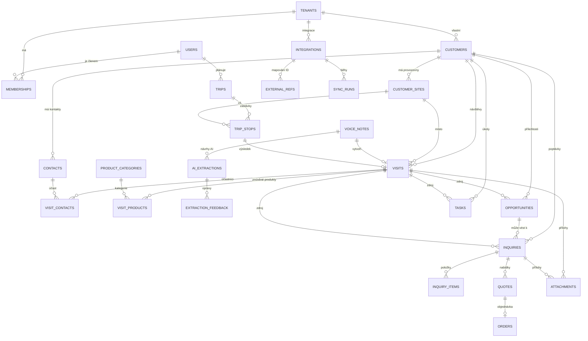
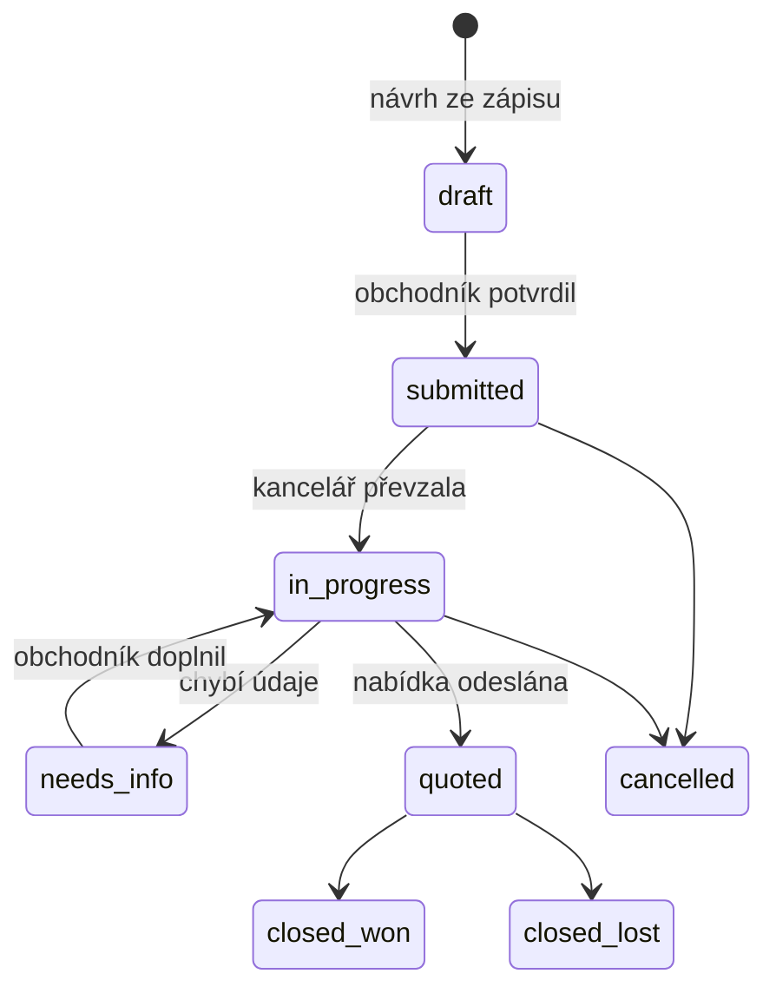
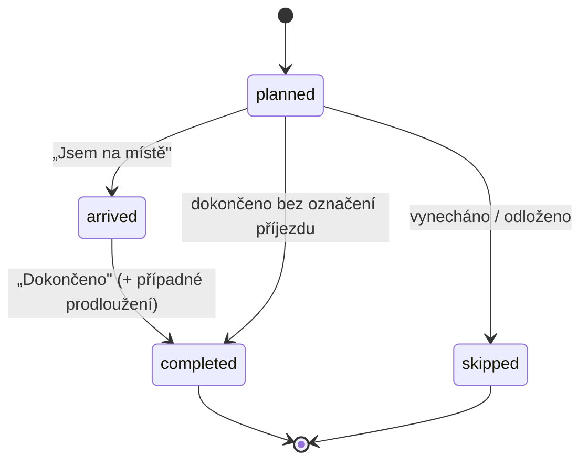

# DATABASE_SCHEMA – Návrh datového modelu

Verze: 1.0 (návrh) · Datum: 13. 11. 2026 · Databáze: PostgreSQL (Supabase) + PostGIS

Dokument popisuje entity, vztahy a pravidla. SQL ukázky slouží jen pro vysvětlení principu – finální
migrace vzniknou až při implementaci.

---

## 1. Principy datového modelu

| Princip | Proč |
|---|---|
| **`tenant_id` v každé firemní tabulce** | Oddělení dat firem (RLS); každý dotaz je vázán na firmu |
| **Složené cizí klíče `(tenant_id, x_id)`** | Databáze nedovolí odkázat na záznam jiné firmy ani při chybě v kódu |
| **UUID jako primární klíče** | Lze je generovat v telefonu offline (idempotentní odeslání), neprozrazují počty záznamů |
| **`timestamptz` pro časy, časová zóna Europe/Prague v aplikaci** | Správné časy i při změně letního/zimního času |
| **Měkké mazání (`deleted_at`) u kmenových dat** | Obnova omylem smazaných záznamů; skutečné smazání řeší retenční úloha (GDPR) |
| **Oddělení AI návrhu od potvrzených dat** | Návrh AI (`ai_extractions`) se nikdy nepřepisuje; potvrzená data jsou v doménových tabulkách |
| **Termíny s přesností** (`*_date` + `*_precision`) | „V lednu" není 1. ledna; zachováme, co obchodník skutečně řekl |
| **Mapování na externí systémy v jedné tabulce** (`external_refs`) | Doménové tabulky nezávisí na konkrétním firemním systému |
| **Číselníky jako `text` + `CHECK`, ne Postgres `ENUM`** | Snadnější přidávání hodnot v migracích |

---

## 2. Přehled vztahů



### Obchodní tok (proč jsou entity oddělené)

```
Návštěva ──(0..n)──► Příležitost ──(0..n)──► Poptávka ──(0..n)──► Nabídka ──(0..1)──► Objednávka
    │                                            ▲
    └──────────────(0..n)────────────────────────┘
                     Poptávka může vzniknout i bez návštěvy (e-mail zákazníka),
                     volitelně s vazbou na návštěvu, která ji „vyvolala".
```

- **Vztahová návštěva** typicky nemá příležitost ani poptávku – a přesto je cenná. Vazba „poptávka
  vyvolaná návštěvou" později umožní ukázat hodnotu vztahových návštěv.
- **Nabídky a objednávky** vznikají ve firemním systému; u nás jsou jen odkazy (číslo, stav), pokud to
  integrace umožní.

---

## 3. Tabulky

Společné sloupce (neuvádí se u každé tabulky): `id uuid PK`, `tenant_id uuid NOT NULL` (kromě `users`),
`created_at timestamptz`, `updated_at timestamptz`.

### 3.1 Identita a firmy

**`tenants`** – zákaznická firma SaaS

| Sloupec | Typ | Popis |
|---|---|---|
| name | text | Název firmy |
| slug | text unique | Krátký identifikátor |
| ico | text null | IČO |
| plan | text | `pilot` / `standard` / `pro` / `enterprise` |
| status | text | `trial` / `active` / `suspended` / `closed` |
| settings | jsonb | Retence (dny), výchozí délka návštěvy, rezerva na parkování, frekvence návštěv dle segmentu, e-mail kanceláře, povolené funkce |

**`users`** – profil uživatele (1:1 s `auth.users` v Supabase)

| Sloupec | Typ | Popis |
|---|---|---|
| id | uuid PK = auth.users.id | |
| email | text | |
| full_name | text | |
| phone | text null | |
| home_label, home_location | text, geography(Point) null | Výchozí místo cest (volitelné) |
| locale | text | `cs-CZ` |

**`memberships`** – členství uživatele ve firmě

| Sloupec | Typ | Popis |
|---|---|---|
| user_id | uuid FK users | |
| role | text | `sales_rep` / `back_office` / `manager` / `admin` |
| status | text | `invited` / `active` / `disabled` |
| is_billable | bool | Počítá se do licencí |
| | | `UNIQUE (tenant_id, user_id)` |

### 3.2 Zákazníci

**`customers`**

| Sloupec | Typ | Popis |
|---|---|---|
| name | text | Obchodní název |
| legal_name | text null | Název dle registru |
| ico | text null | 8 číslic, kontrolní součet ověřen aplikací |
| dic | text null | |
| status | text | `active` / `prospect` / `inactive` |
| segment | text null | Např. A/B/C ❓ `[D-DA-04]` |
| owner_user_id | uuid null FK users | Odpovědný obchodník ❓ `[D-VE-09]` |
| visit_frequency_days | int null | Přepisuje výchozí frekvenci segmentu |
| phone, email, website | text null | Obecné kontakty firmy |
| notes | text null | Trvalé poznámky |
| source | text | `manual` / `import` / `integration` |
| last_visit_at | timestamptz null | Denormalizováno pro rychlé řazení (aktualizuje se při potvrzení návštěvy) |
| deleted_at | timestamptz null | |

**`customer_sites`** – provozovny / adresy

| Sloupec | Typ | Popis |
|---|---|---|
| customer_id | uuid | FK `(tenant_id, customer_id)` |
| label | text | „Sídlo", „Závod Přerov", „Sklad" |
| street, city, postal_code, country | text | `country` výchozí `CZ` |
| formatted_address | text | Adresa pro zobrazení |
| location | geography(Point, 4326) null | Souřadnice |
| geocode_source | text | `manual_pin` / `mapy_com` / `ruian` / `google_place` / `import` |
| geocode_verified | bool | Uživatel potvrdil pin |
| google_place_id | text null | Lze ukládat dlouhodobě (⚠️ OVĚŘIT podmínky) |
| arrival_notes | text null | „Vjezd z boční ulice, hlásit se na vrátnici" |
| is_primary, is_billing | bool | |
| deleted_at | timestamptz null | |

**`contacts`** – osoby u zákazníka

| Sloupec | Typ | Popis |
|---|---|---|
| customer_id | uuid | FK `(tenant_id, customer_id)` |
| site_id | uuid null | Provozovna, kde osoba sídlí |
| title_before | text null | „Ing." |
| first_name | text null | Může chybět (víme jen „pan Novák") |
| last_name | text | |
| position | text null | Funkce (nákup, údržba, technik…) |
| phone, email | text null | |
| notes | text null | Jen pracovně relevantní informace |
| is_active | bool | Osoba odešla z firmy → `false` |
| source | text | `manual` / `import` / `ai_confirmed` / `integration` |
| deleted_at | timestamptz null | |

### 3.3 Návštěvy

**`visits`**

| Sloupec | Typ | Popis |
|---|---|---|
| customer_id | uuid | |
| site_id | uuid null | |
| user_id | uuid | Obchodník |
| trip_stop_id | uuid null | Zastávka plánu, ze které návštěva vznikla |
| voice_note_id | uuid null | Zdrojová nahrávka |
| visit_type | text | `business` / `inquiry` / `relationship` / `follow_up` / `other` |
| visit_type_other | text null | Popis u `other` |
| started_at, ended_at | timestamptz | |
| purpose | text null | Účel návštěvy |
| summary | text | Shrnutí rozhovoru |
| needs | text null | Zjištěné potřeby |
| next_steps | text null | Domluvené další kroky (text) |
| next_contact_date | date null | |
| next_contact_precision | text null | `day` / `week` / `month` / `quarter` / `year` |
| internal_notes | text null | Interní, neodchází do podkladů |
| status | text | `draft` / `confirmed` |
| source | text | `voice` / `manual` / `import` / `integration` |
| confirmed_at, confirmed_by | timestamptz, uuid | |

**`visit_contacts`** – osoby přítomné na návštěvě (M:N): `visit_id`, `contact_id`.

**`visit_products`** – produkty zmíněné při návštěvě

| Sloupec | Typ | Popis |
|---|---|---|
| visit_id | uuid | |
| product_category_id | uuid null | |
| product_id | uuid null | Až bude katalog |
| mention_text | text | Doslovně, např. „válečkový řetěz 12B-1" |
| relation | text | `presented` / `interested` / `discussed_issue` / `currently_uses` |
| notes | text null | |

**`product_categories`** – číselník kategorií (pro pilot podle sortimentu)

| Sloupec | Typ | Popis |
|---|---|---|
| code | text | `roller_chains`, `conveyor_chains`, `sprockets`, `gears_racks`, `belt_drives`, `custom_manufacturing`, `drawing_based` |
| name | text | „Válečkové řetězy", „Dopravní a speciální řetězy", „Řetězová kola", „Ozubená kola a hřebeny", „Řemenové převody", „Zakázková výroba", „Výrobky podle výkresu" |
| parent_id | uuid null | Hierarchie |
| stt_terms | text[] | Pojmy pro slovník přepisu (např. „12B-1", „08B-2", „DIN 8187") ❓ `[D-OB-06]` |

**`products`** (Později – katalog): `category_id`, `code`, `name`, `attributes jsonb`, `is_active`.

### 3.4 Hlas a AI

**`voice_notes`**

| Sloupec | Typ | Popis |
|---|---|---|
| user_id | uuid | |
| client_id | uuid unique | Vygenerováno v telefonu → idempotentní upload |
| customer_hint_id, trip_stop_hint_id | uuid null | Kontext, odkud byl zápis spuštěn |
| recorded_at | timestamptz | |
| storage_path | text | `{tenant_id}/voice/{yyyy}/{mm}/{id}.{ext}` |
| mime_type, duration_sec, size_bytes | text, int, int | |
| status | text | `uploaded` / `transcribing` / `extracting` / `ready_for_review` / `confirmed` / `discarded` / `failed` |
| attempts | int | Počet pokusů o zpracování |
| last_error | text null | Technický kód chyby (bez osobních údajů) |
| transcript | text null | Přepis |
| stt_provider, stt_model | text | |
| audio_delete_after | timestamptz null | Kdy smazat audio (retence) |
| audio_deleted_at | timestamptz null | |

**`ai_extractions`** – každý výstup AI (neměnný záznam)

| Sloupec | Typ | Popis |
|---|---|---|
| voice_note_id | uuid null | |
| customer_id | uuid null | U briefingu |
| kind | text | `visit_note` / `customer_briefing` |
| provider, model, prompt_version, schema_version | text | |
| output | jsonb | Výstup včetně citací a výsledku kontroly |
| tokens_in, tokens_out, latency_ms | int | |
| cost_estimate | numeric null | Pro sledování nákladů |

**`extraction_feedback`** – co uživatel při kontrole změnil

| Sloupec | Typ | Popis |
|---|---|---|
| extraction_id | uuid | |
| field_path | text | Např. `contacts[0].last_name` |
| change_type | text | `accepted` / `edited` / `removed` / `added` |
| ai_value, final_value | jsonb | |

### 3.5 Obchodní případy

**`opportunities`** – příležitosti

| Sloupec | Typ | Popis |
|---|---|---|
| customer_id | uuid | |
| title | text | „Modernizace výrobní linky" |
| description | text null | |
| product_category_id | uuid null | |
| expected_date, expected_precision | date, text null | „příští rok" → 2027 / `year` |
| certainty | text null | `uncertain` / `likely` / `confirmed` – jen pokud zaznělo |
| estimated_value | numeric null | Jen pokud zaznělo; AI nesmí odhadovat |
| status | text | `open` / `inquiry_received` / `won` / `lost` / `dormant` / `cancelled` |
| source_visit_id | uuid null | |
| owner_user_id | uuid | |
| closed_at | timestamptz null | |

**`inquiries`** – poptávky

| Sloupec | Typ | Popis |
|---|---|---|
| customer_id | uuid | |
| contact_id | uuid null | |
| opportunity_id | uuid null | |
| source_visit_id | uuid null | Návštěva, při které vznikla nebo která ji vyvolala |
| channel | text | `visit` / `email` / `phone` / `web` / `other` |
| received_at | timestamptz | |
| quote_requested_by | date null | Do kdy chce zákazník nabídku |
| status | text | `draft` / `submitted` / `in_progress` / `needs_info` / `quoted` / `closed_won` / `closed_lost` / `cancelled` |
| submitted_by_user_id | uuid | Obchodník |
| assigned_to_user_id | uuid null | Kolegyně |
| technical_notes | text null | |

**`inquiry_items`** – položky poptávky

| Sloupec | Typ | Popis |
|---|---|---|
| inquiry_id | uuid | |
| product_category_id, product_id | uuid null | |
| description | text | Jak zaznělo |
| designation | text null | Např. „12B-1" |
| quantity | numeric null | Jen pokud zaznělo |
| unit | text null | `m`, `ks`, `sada`… |
| technical_params | jsonb | Volné parametry (rozteč, materiál, počet zubů…) – vždy s citací/zdrojem |
| notes | text null | |

**`quotes`** – odkazy na nabídky (P3, dle integrace): `inquiry_id`, `customer_id`, `external_number`,
`sent_at`, `valid_until`, `status` (`sent`/`accepted`/`rejected`/`expired`), `total_amount null`,
`currency`, `source` (`integration`/`manual`).

**`orders`** – odkazy na objednávky (Později): `customer_id`, `quote_id null`, `external_number`,
`ordered_at`, `total_amount null`, `source`.

**`interactions`** – následná komunikace mimo návštěvy (P3): `customer_id`, `contact_id`, `user_id`,
`channel` (`phone`/`email`/`other`), `occurred_at`, `summary`, vazby na příležitost/poptávku.

### 3.6 Úkoly

**`tasks`**

| Sloupec | Typ | Popis |
|---|---|---|
| title | text | |
| description | text null | |
| customer_id | uuid null | |
| assignee_user_id | uuid | |
| created_by_user_id | uuid | |
| due_date, due_precision | date, text null | |
| priority | text | `low` / `normal` / `high` |
| status | text | `open` / `in_progress` / `done` / `cancelled` |
| source | text | `ai_visit` / `manual` / `system_rule` / `back_office_request` |
| source_visit_id, opportunity_id, inquiry_id | uuid null | Odkud úkol vznikl / k čemu patří |
| completed_at | timestamptz null | |

### 3.7 Cesty a harmonogram

**`trips`**

| Sloupec | Typ | Popis |
|---|---|---|
| user_id | uuid | |
| trip_date | date | |
| title | text null | „Zlínsko" |
| start_label, start_location | text, geography(Point) | |
| planned_departure_at | timestamptz | |
| actual_departure_at | timestamptz null | |
| end_label, end_location | text, geography(Point) null | Výchozí = start |
| status | text | `draft` / `planned` / `in_progress` / `completed` / `cancelled` |
| parking_buffer_min | int | Rezerva na parkování/vrátnici |
| route_line | geography(LineString) null | Pro „zákazníky podél trasy" |
| notes | text null | |

**`trip_stops`**

| Sloupec | Typ | Popis |
|---|---|---|
| trip_id | uuid | |
| position | int | Pořadí (určuje obchodník) |
| customer_id, site_id | uuid null | Zákazník z DB… |
| adhoc_label, adhoc_address | text null | …nebo jednorázová adresa |
| location | geography(Point) | Cíl navigace |
| constraint_type | text | `fixed` / `flexible` / `open` |
| fixed_start_at | timestamptz null | Pro `fixed` |
| window_start, window_end | time null | Pro `flexible` |
| planned_duration_min | int | |
| extension_min | int | Prodloužení zadané během dne |
| notes | text null | |
| status | text | `planned` / `arrived` / `completed` / `skipped` |
| actual_arrival_at, actual_departure_at | timestamptz null | Pro měření přesnosti odhadů |
| calendar_event_id | uuid null | Pokud vznikla z kalendáře |
| eta_arrival_at, eta_departure_at, travel_min_from_prev, slack_min, conflict | – | **Cache** posledního výpočtu (zdrojem pravdy je výpočet) |

**`route_legs`** – cache dob přejezdů

| Sloupec | Typ | Popis |
|---|---|---|
| origin, destination | geography(Point) | Zaokrouhlené souřadnice |
| departure_bucket | timestamptz | Zaokrouhleno na 15–30 min |
| duration_sec, duration_traffic_sec, distance_m | int | |
| polyline | text null | Zakódovaná trasa |
| provider | text | |
| fetched_at, expires_at | timestamptz | |

### 3.8 Kalendář (P3)

**`calendar_connections`**: `user_id`, `provider` (`google`/`microsoft`/`ics`/`other`), `account_label`,
`scopes`, `secret_ref` (odkaz do Vaultu), `status`, `last_sync_at`.

**`calendar_events`** (cache): `connection_id`, `external_event_id`, `title`, `starts_at`, `ends_at`,
`location_text`, `is_private`, `customer_id null` (navržená/potvrzená vazba), `match_confidence`,
`trip_stop_id null`.

### 3.9 Integrace

**`integrations`**: `system_type` (`csv_import` / `vendor_api_x` / …), `name`, `config jsonb`
(bez tajemství), `secret_ref`, `status`, `capabilities jsonb`.

**`external_refs`**: `integration_id`, `entity_type` (`customer`/`contact`/`visit`/…), `entity_id`,
`external_id`, `external_hash` (detekce změn), `last_synced_at`.
`UNIQUE (integration_id, entity_type, external_id)`.

**`sync_runs`**: `integration_id`, `direction` (`import`/`export`), `started_at`, `finished_at`,
`status`, `stats jsonb` (počty nových/změněných/chyb), `error_summary`.

### 3.10 Ostatní

**`attachments`**: `storage_path`, `filename`, `mime_type`, `size_bytes`, `uploaded_by`,
`visit_id null`, `inquiry_id null`, `customer_id null`, `deleted_at`.
`CHECK` – musí být vyplněna alespoň jedna vazba.

**`notifications`** (odchozí e-maily/push): `type` (`inquiry_handoff`/`review_ready`/`task_reminder`),
`recipient_user_id` nebo `recipient_email`, `payload jsonb`, `status`, `sent_at`, `error`.

**`audit_log`** (append-only): `id bigint`, `actor_user_id null`, `actor_type` (`user`/`system`/
`integration`), `action`, `entity_type`, `entity_id`, `changes jsonb` (změněná pole, bez audia
a přepisů), `ip`, `user_agent`, `created_at`. Bez UPDATE/DELETE pro všechny role aplikace.

**`usage_events`** (telemetrie pilotu): `user_id`, `event` (`recording_started`, `recording_stopped`,
`review_opened`, `note_confirmed`, `navigate_clicked`, `stop_completed`…), `entity_id`, `occurred_at`,
`props jsonb`. Slouží k měření KPI (např. čas od konce nahrávky po potvrzení). Bez polohy.

---

## 4. Stavové automaty

### Poptávka



### Zastávka cesty



Stavy nahrávky jsou v [SYSTEM_ARCHITECTURE.md](SYSTEM_ARCHITECTURE.md), kap. 5.1.

---

## 5. Indexy a vyhledávání

| Účel | Řešení |
|---|---|
| Vyhledávání zákazníků/kontaktů bez diakritiky a s překlepy | `unaccent` + `pg_trgm`, GIN index na `unaccent(lower(name))` |
| Párování „firma ABC" ze zápisu na zákazníka | Trigramová podobnost + omezení na firmu (tenant) |
| Zákazníci v okolí / podél trasy | GIST index na `customer_sites.location`; `ST_DWithin` |
| Řazení podle poslední návštěvy | Index `(tenant_id, last_visit_at)` |
| Úkoly | Index `(tenant_id, assignee_user_id, status, due_date)` |
| Fronta zpracování | Index `(status, updated_at)` na `voice_notes` |
| Všechny tabulky | Index začínající `tenant_id` (RLS filtr) |

---

## 6. Oddělení dat firem (RLS)

Princip: RLS zapnuté na **každé** tabulce; bez politiky je přístup zakázán.

```sql
-- Ilustrace principu, ne finální migrace
alter table customers enable row level security;

create policy customers_tenant_isolation on customers
  for all
  using      (tenant_id = (select (auth.jwt() ->> 'tenant_id')::uuid))
  with check (tenant_id = (select (auth.jwt() ->> 'tenant_id')::uuid));

-- Složený cizí klíč: návštěva může odkazovat jen na zákazníka stejné firmy
alter table customers add unique (tenant_id, id);
alter table visits
  add foreign key (tenant_id, customer_id) references customers (tenant_id, id);
```

Další vrstvy politik podle rolí (např. obchodník vidí jen své cesty; manažer cesty nevidí) se doplní
po rozhodnutí `[D-VE-09]`. Storage politiky kontrolují, že první část cesty souboru je `tenant_id`
z tokenu. Izolaci ověřují automatické testy (SYSTEM_ARCHITECTURE 7.2).

---

## 7. Retence a mazání dat

| Data | Výchozí retence (návrh, potvrdí firma) | Mechanismus |
|---|---|---|
| Audio nahrávky | 30 dní po potvrzení zápisu; nepotvrzené max. 30 dní od nahrání | Denní úloha maže soubory a vyplní `audio_deleted_at` |
| Přepisy a AI výstupy | 12 měsíců (pro audit a zlepšování kvality) | Denní úloha anonymizuje/maže |
| Potvrzené návštěvy, úkoly, poptávky | Po dobu spolupráce | Dle pravidel firmy |
| Kontakty | Do deaktivace + lhůta dle firmy | Smazání na žádost (GDPR) |
| Auditní záznamy | 24 měsíců | Mazání starších |
| Telemetrie | 12 měsíců | Agregace a smazání detailu |
| Cache poloh a tras | Dny (`expires_at`) | Úklid |
| Odchod firmy | Export + smazání do 30 dní | Doložené smazání |

---

## 8. Mapování na firemní systém

Firemní systém je zdrojem pravdy pro kmenová data zákazníků (pokud discovery neurčí jinak):

| Entita | Zdroj pravdy | Směr synchronizace |
|---|---|---|
| Zákazníci, provozovny | Firemní systém ❓ | Firemní systém → my |
| Kontakty | Firemní systém ❓ (možná i my) `[D-IT-03]` | Dle možností |
| Návštěvy | **My** | My → firemní systém (pokud lze zapisovat) |
| Příležitosti, úkoly, cesty | **My** | – |
| Poptávky | My (do předání) | My → firemní systém / kancelář |
| Nabídky, objednávky | Firemní systém | Firemní systém → my (jen odkazy) |

Lokálně upravená pole přicházející z firemního systému se při další synchronizaci nepřepíší bez upozornění
(pravidla konfliktů v INTEGRATION_ANALYSIS, kap. 2.7).

---

## 9. Otevřené otázky ke schématu

| Otázka | Dopad | Discovery |
|---|---|---|
| Vidí obchodníci navzájem své zákazníky a návštěvy? | RLS politiky, role | `[D-VE-09]` |
| Má zákazník segmentaci (A/B/C) ve firemním systému? | Frekvence návštěv | `[D-DA-04]` |
| Jaké identifikátory používá firemní systém (číslo zákazníka, IČO)? | Párování při importu | `[D-DA-02]` |
| Jaké technické parametry jsou u poptávek klíčové? | Struktura `technical_params` | `[D-BO-02]` |
| Mají zákazníci často více provozoven? | UX výběru místa | `[D-OB-03]` |
| Je potřeba více typů u jedné návštěvy? | `visit_type` jako pole | `[D-OB-17]` |
