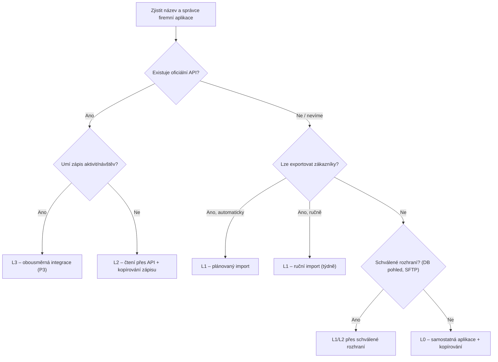

# INTEGRATION_ANALYSIS – Firemní aplikace, kalendář, mapy

Verze: 1.0 (návrh) · Datum: 13. 11. 2026

> **Výchozí stav: o firemních systémech zatím nevíme nic konkrétního.** Neznáme název firemní webové
> aplikace, jejího dodavatele, technologii, kalendář ani pravidla IT. Tento dokument proto nepopisuje,
> jak integrace *funguje*, ale **jak to zjistit** a **jaké varianty máme** podle toho, co zjistíme.
> Nic zde neber jako fakt o systémech MORAVIA ŘETĚZY.

---

## 1. Shrnutí

| Systém | Co víme | Co nevíme ❓ | Doporučený první krok |
|---|---|---|---|
| Firemní webová aplikace | Existuje; obchodník do ní píše zápisy; informace jsou vidět cca po 30 min | Název, dodavatel, hosting, API, export, datový model, kdo ji spravuje | Zjistit název a správce (`[D-IT-01..05]`) |
| Kalendář | Obchodník používá kalendář | Jaký (Google, Microsoft, v aplikaci, v telefonu) | Zjistit systém (`[D-IT-06]`) |
| Mapy | Obchodník používá Google Maps | – | Navigace přes Google Maps URL – nezávisí na firmě |

**Klíčový princip:** aplikace musí být užitečná **i bez integrace** (úroveň L0). Integrace hodnotu
zvyšuje, ale MVP na ní nesmí záviset.

---

## 2. Firemní webová aplikace

### 2.1 Co potřebujeme zjistit

| Oblast | Otázka |
|---|---|
| Identita | Jak se aplikace jmenuje? Kdo je dodavatel? Je to krabicový produkt, nebo zakázkový vývoj? |
| Provoz | Běží v cloudu dodavatele, nebo na serveru firmy (v interní síti)? Je přístupná z internetu, nebo přes VPN? |
| Správa | Kdo ji spravuje (interní IT, externí firma, dodavatel)? Kdo může schválit integraci? |
| API | Má veřejně dokumentované API (REST, SOAP, OData, GraphQL)? Je k němu přístup v licenci, nebo za poplatek? |
| Autentizace API | API klíč, OAuth 2.0, uživatelské jméno + heslo, certifikát? Lze vytvořit servisní účet s omezenými právy? |
| Data | Které entity lze číst a zapisovat: zákazníci, provozovny, kontakty, aktivity/návštěvy, poptávky, nabídky, objednávky, kalendář? |
| Změny | Lze se ptát „co se změnilo od…" (pole `updated_at`)? Existují webhooky (oznámení o změně)? |
| Limity | Omezení počtu požadavků, testovací prostředí (sandbox)? |
| Export/import | Lze exportovat zákazníky a kontakty do CSV/XLSX? Ručně, nebo automaticky? Lze importovat aktivity? |
| Zpoždění 30 min | Proč jsou zápisy vidět až po ~30 min? (dávková synchronizace, replikace, cache, schvalování?) |
| Smlouva | Povoluje licenční smlouva napojení třetí strany? Jsou s tím spojené náklady? |

### 2.2 Jak systém legitimně identifikovat (postup)

1. **Zeptat se** obchodníka a kolegyně: jak aplikaci říkají, jakou adresu zadávají do prohlížeče, kdo
   jim pomáhá při problémech.
2. **Podívat se** na přihlašovací stránku, patičku, nápovědu, „O aplikaci" – bývá tam název produktu,
   dodavatel a verze.
3. **Kontaktovat správce** (interní IT nebo dodavatele) s žádostí o dokumentaci integračních možností.
   Šablona žádosti je v kap. 2.11.
4. **Vyžádat si vzorový export** zákazníků (anonymizovaný nebo s fiktivními daty) a seznam polí.
5. **Teprve po písemném souhlasu** správce se zkouší technické napojení – na testovacím prostředí, se
   servisním účtem.

**Co nedělat:** nezkoumat síťovou komunikaci aplikace s cílem objevit neveřejné API, nepoužívat přihlašovací
údaje obchodníka pro automatický přístup, nepoužívat scraping nebo robotické ovládání bez výslovného
písemného souhlasu vlastníka systému. Je to v rozporu se zadáním a může porušovat licenční smlouvu
i bezpečnostní pravidla firmy.

### 2.3 Hodnocení integračních variant (preferované pořadí podle zadání)

| # | Varianta | Náročnost | Spolehlivost | Aktuálnost dat | Riziko | Poznámka |
|---|---|---|---|---|---|---|
| 1 | **Oficiální API** | Střední | Vysoká | Minuty / okamžitě | Nízké | Ideální; obousměrné, pokud API umí zápis |
| 2 | **Oficiální export/import** (CSV/XLSX, plánovaný) | Nízká | Střední | Hodiny / den | Nízké | Realistický start; import zákazníků, export návštěv |
| 3 | **Schválené integrační rozhraní** (DB pohled jen pro čtení, SFTP složka, integrační platforma dodavatele) | Střední | Střední–vysoká | Dle frekvence | Nízké–střední | Musí nastavit správce systému |
| 4 | **Jiná povolená automatizace** (e-mail do systému, RPA se souhlasem) | Střední–vysoká | Nízká–střední | Různá | Střední | Křehké; jen se souhlasem a pokud 1–3 nejde |
| 5 | **Bez integrace** (L0) | Nejnižší | – | – | Nízké | Aplikace funguje samostatně; výstup se přenese ručně (kap. 2.10) |

### 2.4 Úrovně integrace a chování aplikace

| Úroveň | Popis | Zákazníci v aplikaci | Zápisy do firemního systému |
|---|---|---|---|
| **L0** | Bez integrace | Ruční zadání / jednorázový import | Obchodník zkopíruje připravený text (1 klepnutí) |
| **L1** | Export/import souborů | Pravidelný import (např. týdně) | Hromadný export návštěv (CSV), import správcem |
| **L2** | API jen pro čtení | Automatická synchronizace (např. každou hodinu) | Jako L0/L1 |
| **L3** | Obousměrné API | Automatická synchronizace | Automaticky po potvrzení zápisu |

Aplikace zjistí úroveň z `capabilities()` konektoru (SYSTEM_ARCHITECTURE, kap. 9) a podle toho zobrazí
např. tlačítko „Kopírovat do firemní aplikace" (L0) nebo stav „Zapsáno do systému ✓" (L3).

**Doporučení pro MVP:** počítat s **L0 + jednorázovým importem (L1)**. Integraci L2/L3 implementovat v P3,
pokud discovery ukáže API.

### 2.5 Zdroj pravdy

Viz [DATABASE_SCHEMA.md](DATABASE_SCHEMA.md), kap. 8. Shrnutí: kmenová data zákazníků patří firemnímu
systému, zápisy z návštěv, příležitosti, úkoly a cesty vznikají u nás.

### 2.6 Jak získávat jednotlivá data (dle varianty)

| Data | API (L2/L3) | Export/import (L1) | Bez integrace (L0) |
|---|---|---|---|
| Zákazníci a adresy | Synchronizace změn | Import CSV s mapováním sloupců | Ruční zadání, ARES podle IČO |
| Kontakty | Synchronizace | Import CSV | Ruční / ze zápisů (po potvrzení) |
| Historie návštěv | Jednorázové načtení + průběžně | Jednorázový import | Začínáme „od nuly" |
| Kalendář | Viz kap. 3 | – | – |
| Zápis nových návštěv | Zápis přes API po potvrzení | Export CSV | Kopírování textu |
| Nabídky, objednávky | Čtení stavů | Import přehledu | Nezobrazujeme |

### 2.7 Synchronizace (pro L1–L3)

- **Stahování:** přírůstkově podle data změny; na začátku jednorázový plný import.
- **Odesílání:** po potvrzení zápisu, s idempotentním klíčem (opakování nevytvoří duplicitu);
  neúspěch → opakování s prodlevou, po 3 neúspěších upozornění adminovi.
- **Mapování ID:** tabulka `external_refs` (naše ID ↔ ID ve firemním systému).
- **Konflikty:** u kmenových dat vyhrává firemní systém; pokud uživatel u nás pole změnil a zároveň se
  změnilo ve firemním systému, záznam se označí ke kontrole (nepřepisuje se potichu).
- **Mazání:** zákazník smazaný ve firemním systému se u nás označí jako neaktivní, historie zůstane.
- **Log:** každý běh v `sync_runs` (počty, chyby) – admin vidí stav integrace.

### 2.8 Pokud firemní systém běží jen v interní síti

| Možnost | Hodnocení |
|---|---|
| API dodavatele dostupné z internetu (pokud existuje) | Nejlepší |
| Export do sdílené složky / SFTP, odkud si soubory bereme | Jednoduché, bezpečné |
| Malý konektor instalovaný ve firmě, který se připojuje **ven** k nám (odchozí spojení) | Bezpečnější než otevírat firewall; až později |
| VPN z naší aplikace do firemní sítě | Nedoporučuji – rozšiřuje přístup do celé sítě firmy |

### 2.9 Bezpečnostní pravidla integrace

1. Písemný souhlas vlastníka systému (vedení + správce/dodavatel) před jakýmkoli napojením.
2. **Servisní účet** s minimálními právy (jen potřebné entity, ideálně jen čtení + zápis aktivit).
   Nikdy osobní účet obchodníka.
3. Přístupové údaje v šifrovaném trezoru; rotace; možnost okamžitého zneplatnění.
4. Nejdřív testovací prostředí, pak produkce.
5. Každý zápis do firemního systému auditovaný a dohledatelný.
6. Žádné obcházení autentizace, CAPTCHA ani omezení počtu požadavků.

### 2.10 Fungování bez integrace (L0) – stále užitečné

I bez napojení ušetří aplikace většinu času:

1. **Zákazníci:** jednorázový import exportu (nebo ruční zadání postupně při návštěvách).
2. **Zápis:** diktát → strukturovaný zápis → po potvrzení tlačítko **„Kopírovat pro firemní aplikaci"**,
   které připraví text přesně ve struktuře polí firemní aplikace (šablonu nastavíme podle discovery
   `[D-OB-07]`). Vložení zabere desítky sekund místo ~10 minut psaní.
3. **Kancelář:** poptávka se kolegyni pošle e-mailem / zobrazí v přehledu poptávek (FR-H-03/04).
4. **Historie:** od začátku pilotu se buduje v naší aplikaci.

Riziko L0: dvojí evidence (u nás a ve firemním systému). Proto ji chápeme jako přechodný stav.

### 2.11 Šablona žádosti správci/dodavateli

> Dobrý den, připravujeme pro obchodní oddělení pilotní mobilní aplikaci pro zápisy z návštěv.
> Rádi bychom zjistili, zda [název aplikace] nabízí oficiální možnost integrace. Konkrétně:
> 1) existuje API nebo jiné integrační rozhraní a jeho dokumentace, 2) způsob autentizace a možnost
> servisního účtu s omezenými právy, 3) které entity lze číst/zapisovat (zákazníci, kontakty, aktivity/
> návštěvy, nabídky), 4) možnosti exportu/importu (formáty, automatizace), 5) testovací prostředí,
> 6) případné licenční podmínky a náklady. Integrace bude probíhat jen s vaším souhlasem a podle
> vašich bezpečnostních pravidel. Děkujeme.

### 2.12 Rozhodovací strom



---

## 3. Kalendář

### 3.1 Možné varianty (zatím nevíme, která platí ❓ `[D-IT-06]`)

| Varianta | Jak integrovat | Oprávnění | Poznámky |
|---|---|---|---|
| Google Workspace (Google Calendar) | Google Calendar API, OAuth 2.0 | Čtení událostí; zápis jen pokud chceme vytvářet události | Správce Workspace může omezovat aplikace třetích stran |
| Microsoft 365 / Exchange Online (Outlook) | Microsoft Graph API, OAuth 2.0 | `Calendars.Read` / `Calendars.ReadWrite` (delegovaně) | Firemní tenant může vyžadovat souhlas správce |
| Exchange na vlastním serveru | EWS / jiné rozhraní – dle verze | Dle správce | Složitější; ověřit s IT |
| Kalendář uvnitř firemní aplikace | Podle API firemní aplikace (kap. 2) | – | Závisí na integraci |
| Kalendář jen v telefonu | Nelze číst z webové aplikace | – | Alternativa: export ICS, nebo zadávat pevné schůzky přímo v plánovači |
| Žádný sdílený kalendář | – | – | Plánovač slouží jako kalendář cest |

### 3.2 Požadované funkce a jak je pokrýt

| Funkce (zadání) | Řešení |
|---|---|
| Načítání schůzek, denní program | Čtení událostí pracovního kalendáře na 14 dní dopředu |
| Propojení schůzek se zákazníky | Návrh podle místa/názvu události (párování jako u zápisu), potvrzení uživatelem |
| Zobrazení adres | Z karty zákazníka (ověřená adresa), ne z textu události |
| Přehled dalších návštěv | Sloučení událostí a plánu cesty |
| Vytváření následných úkolů / nové události | Zápis události (vyžaduje oprávnění k zápisu) |

### 3.3 Doporučení

1. Nejdřív zjistit systém.
2. Pokud jde o Google nebo Microsoft 365: v P2/P3 **jen čtení** pevných schůzek do plánovače (nejvyšší
   hodnota, nejmenší riziko). Zápis událostí až později.
3. Soukromé události nezobrazovat a neukládat (jen „obsazeno").
4. Do té doby obchodník zadává pevné schůzky přímo v plánovači (FIXED).

---

## 4. Mapy a navigace

### 4.1 Co potřebujeme

| Potřeba | Kde | Nutné placené API? |
|---|---|---|
| Spustit navigaci do Google Maps | Tlačítko Navigovat | **Ne** – stačí URL odkaz |
| Převod adresy na souřadnice (geokódování) | Import zákazníků, nová adresa | Ano (nebo veřejná data) |
| Zobrazení mapy se zastávkami | Plánovač, V okolí | Ano |
| Doby přejezdů s dopravou | Harmonogram | Ano |
| Zákazníci v okolí / podél trasy | Modul E | **Ne** – vlastní DB (PostGIS) |
| Vyhledání firmy podle IČO | Nový zákazník | Ne – ARES (veřejný registr) |

### 4.2 Navigace – odkaz do Google Maps

Formát odkazu (Google Maps URLs, ⚠️ OVĚŘIT aktuální dokumentaci):

```
https://www.google.com/maps/dir/?api=1&destination=49.4554,17.4510&travelmode=driving&dir_action=navigate
```

- Používat **ověřené souřadnice** provozovny (nikoli text adresy) → spolehlivý cíl.
- Pokud adresa není ověřena, použít textovou adresu a zobrazit upozornění.
- Naviguje se vždy jen na **další zastávku** (zadání to tak chce a odpadá omezení počtu průjezdních bodů).

### 4.3 Srovnání poskytovatelů

| Kritérium | Google Maps Platform | Mapy.com API (Seznam.cz) | Open-source (OSM, OSRM/ORS, MapLibre) |
|---|---|---|---|
| Kvalita českých adres | Dobrá | Velmi dobrá (lokální poskytovatel) | Proměnlivá |
| Doprava v reálném čase / predikce | Ano (Routes API) | ⚠️ OVĚŘIT | Ne (bez vlastních dat) |
| Navigace v aplikaci obchodníka | Google Maps (stejný ekosystém) | Mapy.com (jiná aplikace) | – |
| Ukládání souřadnic z geokódování | Omezené podmínkami (⚠️ OVĚŘIT) | ⚠️ OVĚŘIT | Volné (licence ODbL) |
| Cena | Bezplatný měsíční limit, pak za požadavek (⚠️ OVĚŘIT) | Bezplatná úroveň, pak kredity (⚠️ OVĚŘIT) | Zdarma, ale vlastní provoz |

### 4.4 Doporučení

| Funkce | MVP volba | Alternativa |
|---|---|---|
| Navigace | Google Maps URL | – |
| Doby přejezdů s dopravou | Google Routes API (predikce pro budoucí odjezd, aktualizace během dne) | Mapy.com routing, pokud bude dostačující |
| Zobrazení mapy | Google Maps JavaScript API | MapLibre + dlaždice Mapy.com (úspora) |
| Geokódování k trvalému uložení | Mapy.com API nebo RÚIAN + **potvrzení pinu uživatelem** | Google Geocoding s uložením jen Place ID |
| V okolí | PostGIS ve vlastní DB | – |
| IČO → název a sídlo | ARES (REST API ministerstva financí) | – |

**Proč tolik pozornosti geokódování:** souřadnice zákazníků jsou trvalá data, na kterých stojí navigace
i „zákazníci v okolí". Uživatelem potvrzený pin je naše vlastní informace a lze ji uchovávat bez omezení.

### 4.5 Kontrola nákladů na mapy

- Cache dob přejezdů (`route_legs`), žádné průběžné dotazování.
- Přepočet během dne jen při událostech a s omezením frekvence.
- Rozpočtové limity a upozornění v konzoli poskytovatele.
- Odhad pro jednoho obchodníka: stovky požadavků měsíčně → pravděpodobně v bezplatném limitu
  (⚠️ OVĚŘIT, BUSINESS_MODEL kap. 5).

---

## 5. Další integrace

| Služba | Účel | Priorita | Poznámka |
|---|---|---|---|
| ARES | Doplnění názvu a sídla podle IČO | P2 | Veřejné, bez poplatku (⚠️ OVĚŘIT limity) |
| RÚIAN | Ověření adres, souřadnice adresních míst | P2 | Otevřená data státu |
| Transakční e-mail | Předání poptávky, pozvánky | P1 | Poskytovatel se zpracováním v EU |
| AI poskytovatel(é) | Přepis, strukturování | P1 | Zpracovatel osobních údajů → DPA |
| Příjem e-mailových poptávek | Evidence poptávek, které přijdou e-mailem | Později | Napojení na schránku kanceláře |
| Telefonie | Záznam hovorů jako interakcí | Později | Mimo MVP |

---

## 6. Další kroky

1. Discovery rozhovory s otázkami `[D-IT-*]` a `[D-OB-07]` (DISCOVERY_CHECKLIST).
2. Vyžádat vzorový export zákazníků (anonymizovaný).
3. Odeslat žádost správci/dodavateli (kap. 2.11).
4. Podle odpovědí zvolit úroveň integrace pro MVP a aktualizovat tento dokument.
