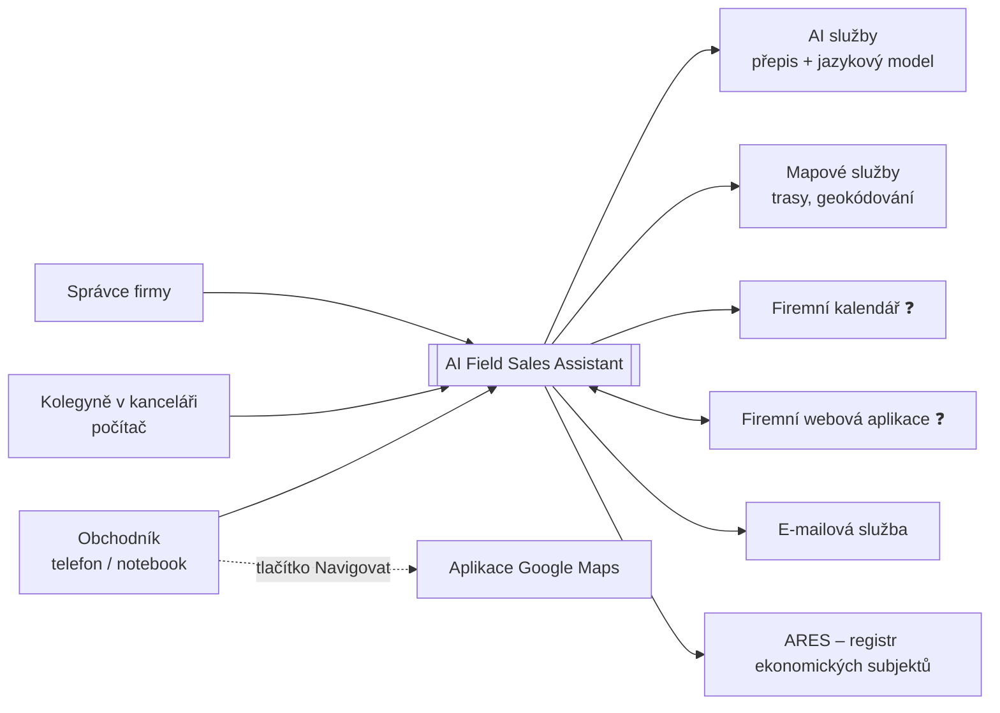
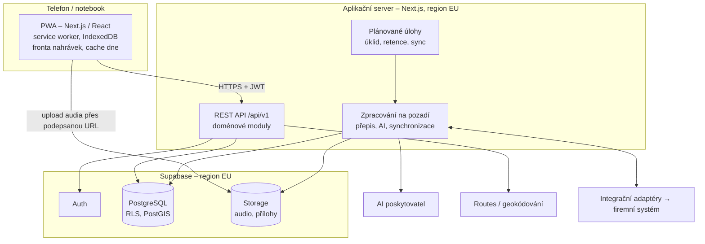
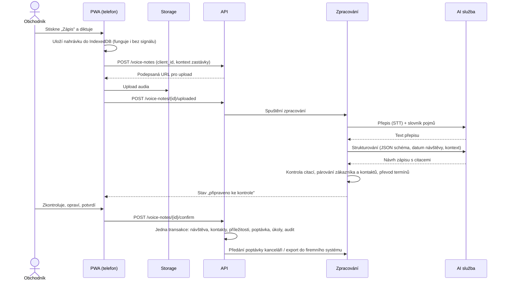
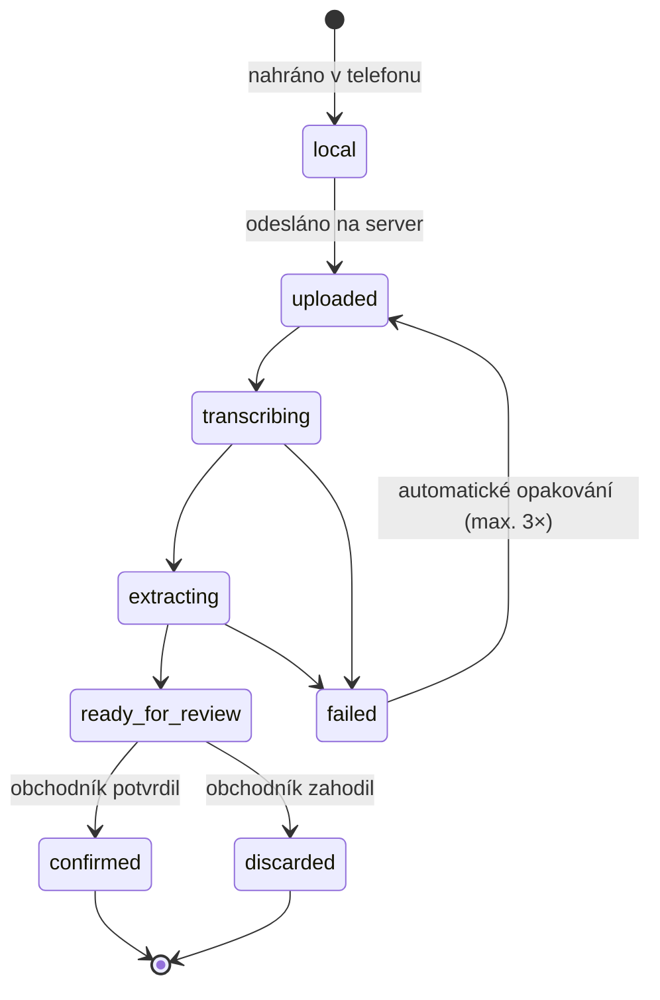

# SYSTEM_ARCHITECTURE – AI Field Sales Assistant

Verze: 1.0 (návrh) · Datum: 13. 11. 2026

Dokument popisuje navrženou technickou architekturu, doporučené technologie a **důvody** rozhodnutí.
Rozhodnutí jsou zapsána jako ADR (Architecture Decision Record) v kapitole 10 – vždy s alternativami
a s tím, kdy rozhodnutí přehodnotit.

---

## 0. Shrnutí doporučení

| Vrstva | Doporučení | Proč (stručně) |
|---|---|---|
| Klient | **PWA** (webová aplikace instalovatelná na telefon) v **Next.js + React + TypeScript** | Jedna kódová báze pro telefon, notebook i kancelář; bez obchodů s aplikacemi |
| Server / API | **Next.js Route Handlers** – REST API `/api/v1`, **modulární monolit** | Jedna aplikace, jedno nasazení, jeden jazyk |
| Databáze | **PostgreSQL** ve **Supabase** (region EU) + PostGIS + pg_trgm/unaccent | Relační data, RLS pro oddělení firem, geodotazy, vyhledávání bez diakritiky |
| Přihlášení | **Supabase Auth** | Hotové, bezpečné, napojené na RLS |
| Soubory | **Supabase Storage** (privátní, cesty podle firmy) | Audio a přílohy pod stejnými pravidly přístupu |
| Zpracování na pozadí | **Stavový automat v DB + serverová funkce + plánovaný úklid** | Nejjednodušší spolehlivé řešení; později skutečná fronta |
| AI | **Vlastní abstraktní vrstva**; pilot s **OpenAI API** (přepis + strukturování) | Vyměnitelný poskytovatel; jeden dodavatel = jednodušší GDPR v pilotu |
| Mapy | **Google Maps URL** (navigace, zdarma) + **Google Routes API** (časy s dopravou); geokódování s ohledem na licence | Navigace v aplikaci, kterou obchodník zná |
| Hosting | **Vercel (EU region) + Supabase (EU)**, aplikace přenositelná (Docker) | Nulová správa serverů v pilotu |
| Automatizace (n8n) | **Ne v jádru**, případně později pro zakázkové integrace | Testovatelnost, verzování, licence |

---

## 1. Architektonické principy

1. **Modulární monolit** – jedna aplikace rozdělená na doménové moduly s jasnými hranicemi.
   Mikroslužby by pro jednoho vývojáře znamenaly zbytečnou režii.
2. **API-first** – klient komunikuje se serverem jen přes verzované REST API. Důvod: offline fronta
   v telefonu musí umět akce znovu odeslat a případná budoucí nativní aplikace použije stejné API.
3. **Oddělení firem vynucené databází** – nejen kódem. Chyba v aplikaci nesmí zpřístupnit data jiné firmy.
4. **Deterministický kód tam, kde to jde; AI jen tam, kde přináší hodnotu.** Výpočty časů, párování
   zákazníků, převody dat a kontrola výstupů AI jsou běžný testovatelný kód.
5. **Idempotence** – každá operace, která se může opakovat (upload, zpracování, synchronizace), má
   jednoznačný klíč, takže opakování nezpůsobí duplicitu.
6. **Sdílená doménová logika** – výpočet harmonogramu je čistá funkce v TypeScriptu, která běží
   v telefonu (okamžitě a offline) i na serveru.
7. **Pozorovatelnost bez osobních údajů** – logy a chybová hlášení obsahují ID, nikdy obsah zápisů.

---

## 2. Kontext systému (kdo a co se systémem komunikuje)



---

## 3. Kontejnery (z čeho se systém skládá)



| Kontejner | Odpovědnost | Poznámka |
|---|---|---|
| **PWA klient** | UI, nahrávání zvuku, offline fronta, cache dnešního dne, výpočet harmonogramu | Funguje na telefonu i v prohlížeči notebooku |
| **REST API** | Autentizace požadavků, validace (Zod), doménová logika, transakce | Route Handlers v Next.js |
| **Zpracování na pozadí** | Přepis, AI strukturování, briefingy, synchronizace s firemním systémem | Spouští se po uploadu; cron dohání nedokončené |
| **PostgreSQL** | Veškerá data, RLS politiky, geodotazy | Supabase, EU region |
| **Storage** | Audio nahrávky, fotky, výkresy | Audio se nahrává **přímo** z telefonu přes podepsanou URL – serverless funkce mají limit velikosti požadavku (⚠️ OVĚŘIT, u Vercelu řádově jednotky MB) |
| **Integrační adaptéry** | Převod dat mezi naším modelem a firemním systémem | Konkrétní podoba závisí na discovery |

---

## 4. Doménové moduly

| Modul | Odpovědnost | Hlavní entity | Etapa |
|---|---|---|---|
| `identity` | Přihlášení, firmy (tenanti), členství, role | tenants, users, memberships | P1 |
| `customers` | Zákazníci, provozovny, kontakty, import, ověření adres | customers, customer_sites, contacts | P1 |
| `visits` | Návštěvy, typy, zmíněné produkty, přílohy | visits, visit_contacts, visit_products, attachments | P1 |
| `voice` | Nahrávky, upload, stavový automat zpracování | voice_notes | P1 |
| `ai` | Přepis, extrakce, briefing, prompty, evaluace | ai_extractions, extraction_feedback | P1 |
| `pipeline` | Příležitosti, poptávky, odkazy na nabídky/objednávky | opportunities, inquiries, inquiry_items, quotes, orders | P1 (základ) |
| `tasks` | Úkoly a follow-upy | tasks | P1 (základ) |
| `trips` | Cesty, zastávky, **výpočet harmonogramu**, konflikty | trips, trip_stops | P2 |
| `geo` | Geokódování, vzdálenosti, cache přejezdů | route_legs | P1/P2 |
| `calendar` | Napojení na kalendář | calendar_connections, calendar_events | P3 |
| `integrations` | Konektory, mapování ID, synchronizace | integrations, external_refs, sync_runs | P1 (import CSV), P3 |
| `notifications` | E-maily (předání poptávky), push | notifications | P1-lite |
| `audit` | Auditní záznamy | audit_log | P1 |
| `billing` | Licence, předplatné | (později) | Později |

**Pravidlo hranic:** modul pracuje se svými tabulkami; data jiného modulu získává přes jeho servisní
funkce. Díky tomu půjde modul později vyčlenit nebo přepsat, aniž by se rozbil zbytek.

---

## 5. Klíčové toky

### 5.1 Hlasový zápis – od diktátu po uložení



**Stavy nahrávky:**



Stav `local` existuje jen v telefonu. Nahrávka se z telefonu smaže až po potvrzení, že ji server přijal.

### 5.2 AI pipeline podrobně

| Krok | Kdo | Vstup | Výstup |
|---|---|---|---|
| 1. Přepis (STT) | AI služba | Audio, jazyk `cs`, slovník (produktové pojmy, jména zákazníků z dnešního plánu) | Text přepisu |
| 2. Strukturování | Jazykový model | Přepis, datum a čas návštěvy, předpokládaný zákazník (z plánu), seznam jeho kontaktů (jen jméno + funkce), číselník kategorií produktů, definice typů návštěv | JSON podle schématu; u každého údaje **citace** z přepisu |
| 3. Kontrola výstupu | Náš kód | JSON + přepis | Pole bez doložené citace se označí jako nepodložená a nevyplní se |
| 4. Párování entit | Náš kód + DB | Zmínky o firmě, osobách, produktech | Návrh zákazníka/kontaktu s mírou jistoty, nebo dotaz na uživatele |
| 5. Převod termínů | Náš kód | „v lednu", „příští středu" + datum návštěvy | Datum + přesnost (den/týden/měsíc/čtvrtletí/rok) + původní výraz |
| 6. Kontrola uživatelem | Obchodník | Návrh zápisu | Potvrzená data |
| 7. Uložení | API | Potvrzená data | Záznamy v DB + rozdíl „AI vs. finální" pro měření kvality |

#### Příklad

Diktát (ze zadání): *„Dnes jsem byl u firmy ABC. Jednal jsem s panem Novákem. Ukazoval jsem jim nové
válečkové řetězy. Zatím nemají konkrétní poptávku, ale možná budou příští rok modernizovat výrobní linku.
Mám se jim ozvat v lednu."*

Výstup jazykového modelu (krok 2, zkráceně):

```json
{
  "customer_mention": { "text": "firma ABC", "evidence": "byl u firmy ABC" },
  "contacts": [
    { "salutation": "pan", "first_name": null, "last_name": "Novák", "position": null,
      "evidence": "Jednal jsem s panem Novákem" }
  ],
  "visit_type": { "value": "business",
    "reason": "Představení produktů, konkrétní poptávka zatím není",
    "evidence": "Ukazoval jsem jim nové válečkové řetězy" },
  "purpose": null,
  "summary": "Představeny nové válečkové řetězy. Konkrétní poptávka zatím není.",
  "products": [
    { "category": "roller_chains", "text": "nové válečkové řetězy", "relation": "presented",
      "evidence": "Ukazoval jsem jim nové válečkové řetězy" }
  ],
  "needs": [],
  "opportunities": [
    { "title": "Možná modernizace výrobní linky", "timeframe_text": "příští rok",
      "certainty": "uncertain",
      "evidence": "možná budou příští rok modernizovat výrobní linku" }
  ],
  "inquiries": [],
  "tasks": [
    { "title": "Ozvat se zákazníkovi", "due_text": "v lednu", "evidence": "Mám se jim ozvat v lednu" }
  ],
  "next_contact": { "due_text": "v lednu", "evidence": "Mám se jim ozvat v lednu" },
  "internal_notes": null,
  "uncertainties": ["Křestní jméno ani funkce pana Nováka nezazněly."]
}
```

Po krocích 3–5 (náš kód), při datu návštěvy 13. 11. 2026:

- **Zákazník:** návštěva byla spuštěna ze zastávky „ABC s.r.o., závod Přerov" → navrženo s vysokou jistotou.
  Kdyby diktát zmiňoval jinou firmu než plán, aplikace se zeptá.
- **Kontakt:** u ABC s.r.o. je jediný Novák (Jan Novák, nákup) → navrženo **k potvrzení**. Kdyby byl
  Novák dva, nebo žádný, uživatel vybere / založí nový kontakt (bez vymyšleného křestního jména).
- **Termíny:** „v lednu" → leden 2027 (přesnost: měsíc), úkol s termínem 4. 1. 2027 (první pracovní den);
  „příští rok" → 2027 (přesnost: rok). Uživatel může termín upřesnit.
- **Poptávka:** žádná → nic se kanceláři neodesílá.

#### Ochrana proti domýšlení („halucinacím")

1. **Instrukce a příklady** v promptu: co nezaznělo, je `null`; včetně negativních příkladů.
2. **Schéma** s povinnou citací, výčtovými typy a možností `null`. Ve schématu zápisu **nejsou** pole
   pro ceny, dostupnost ani dodací termíny – pokud je obchodník zmíní, uloží se jen jako citovaný text.
3. **Kontrola citací kódem** – citace musí v přepisu skutečně existovat (tolerance na diakritiku a mezery).
4. **Kontrola nových údajů ve volném textu** – čísla, jména a označení produktů ve shrnutí musí
   existovat v přepisu; jinak se shrnutí označí k revizi.
5. **Seznam nejasností** se zobrazí uživateli jako otázky.
6. **Povinné potvrzení** – nic se neuloží bez kontroly obchodníkem.
7. **Měření** – každá oprava při kontrole se uloží (`extraction_feedback`) → víme, kde AI chybuje.

#### Verzování a evaluace

- Prompty a JSON schémata jsou soubory v repozitáři s číslem verze; každý výsledek ukládá
  `provider`, `model`, `prompt_version`.
- **Evaluační sada:** 20–30 fiktivních diktátů (namluví obchodník s realistickou terminologií) s ručně
  připraveným očekávaným výstupem. Před každou změnou promptu nebo modelu se sada spustí a porovná.
- Metriky: přesnost přepisu technických termínů, úplnost extrakce (recall) po polích, podíl
  nepodložených údajů, přesnost párování zákazníka/kontaktu.

#### Minimalizace dat posílaných AI

Posílá se jen přepis a nezbytný kontext. **Neposílá se** celá zákaznická databáze – párování probíhá
u nás v DB. Slovník pro přepis obsahuje jen názvy dnes plánovaných zákazníků (kompromis mezi přesností
a minimalizací). U poskytovatele se nastaví co nejkratší uchovávání dat a vyloučení z tréninku
(⚠️ OVĚŘIT aktuální smluvní podmínky).

#### Latence a náklady (orientačně, ⚠️ OVĚŘIT)

Cíl: 2minutový diktát → návrh ke kontrole do 60 s (p90). Odhad nákladů na jeden zápis je v řádu
jednotek Kč (BUSINESS_MODEL, kap. 5).

### 5.3 Briefing před návštěvou

Briefing má dvě vizuálně oddělené části:

1. **Fakta** (deterministicky z DB): poslední návštěva (datum, typ, kdo), kontakty, otevřené příležitosti,
   poptávky, nabídky, úkoly, poslední domluvený krok, produkty, o které byl zájem.
2. **Shrnutí AI** (volitelné): 3–5 bodů „na co se zaměřit". Vstupem je posledních ~5 potvrzených zápisů
   a otevřené položky. Každý bod odkazuje na zdrojovou návštěvu. Při nedostatku historie se nezobrazí
   („Zatím málo historie pro shrnutí").

Shrnutí se generuje po potvrzení nové návštěvy a pro zákazníky v zítřejším plánu (aby bylo v telefonu
dostupné i offline). Ukládá se jako cache.

### 5.4 Plánovač a výpočet harmonogramu

Výpočet je **čistá funkce** (`computeSchedule`) bez přístupu k síti a databázi:

- **Vstup:** čas a místo odjezdu, seřazené zastávky (typ omezení, délka, prodloužení, stav),
  doby přejezdů mezi body, nastavení (rezerva na parkování/vrátnici, výchozí délka návštěvy), aktuální čas.
- **Výstup:** pro každou zastávku příjezd, začátek, odjezd, doba jízdy, čekání, rezerva, konflikty;
  odhad návratu.

Algoritmus (dopředný průchod):

```
t ← čas odjezdu z výchozího bodu
    (během dne: skutečný odjezd z poslední dokončené zastávky)
pro každou nedokončenou zastávku i v pořadí:
    jízda_i   ← doba přejezdu z předchozího bodu (s dopravou)
    příjezd_i ← t + jízda_i + rezerva_na_parkování
    FIXED (T):      začátek_i ← max(příjezd_i, T)
                    příjezd_i > T  → KONFLIKT (zpoždění = příjezd_i − T)
    FLEXIBLE (a,b): začátek_i ← max(příjezd_i, a)
                    začátek_i > b  → VAROVÁNÍ (mimo preferované okno)
    OPEN:           začátek_i ← příjezd_i
    odjezd_i  ← začátek_i + plánovaná_délka_i + prodloužení_i
    t ← odjezd_i
návrat ← t + jízda(poslední zastávka → cíl)
```

**Rezerva** u zastávky = o kolik minut se může návštěva protáhnout, než vznikne konflikt s nejbližší
následující pevnou schůzkou (započítává čekání u flexibilních zastávek). Počítá se simulací – výpočet
je tak rychlý, že to nevadí.

**Konflikt s pevnou schůzkou** – systém nikdy sám nic nepřesune. Nabídne možnosti s náhledem nových časů:

1. Zkrátit návštěvy před pevnou schůzkou (o kolik).
2. Přesunout OPEN zastávku za pevnou schůzku.
3. Odložit OPEN/FLEXIBLE zastávku na jiný den.
4. Zavolat kontaktu pevné schůzky (přímé tlačítko).

**Doby přejezdů:**

- Při plánování (1–2 dny předem) se použije **predikce dopravy pro budoucí čas odjezdu**
  (Google Routes API, ⚠️ OVĚŘIT parametry a cenu).
- Během dne se zbývající úseky obnoví při událostech (dokončení zastávky, změna pořadí, ruční „obnovit"),
  nejvýše cca každých 15 minut, a jen když je aplikace otevřená – nikoli průběžně (náklady, baterie).
- Úseky se ukládají do cache. Offline se použijí poslední známé hodnoty s označením
  „odhad bez aktuální dopravy".

### 5.5 Zákazníci v okolí

- Poloha telefonu se zjistí **jen na vyžádání** a pošle se jako parametr dotazu; **neukládá se ani neloguje**.
- Dotaz v DB přes PostGIS: provozovny do vzdálenosti X km, seřazené podle vzdušné vzdálenosti.
  Bez nákladů na mapové API.
- „Podél trasy": trasa cesty je uložena jako linie; hledají se provozovny do X km od linie.
- Skutečnou zajížďku (v minutách) spočítá Routes API jen pro vybrané kandidáty na vyžádání.

### 5.6 Předání poptávky do kanceláře

- Pokud potvrzený zápis obsahuje poptávku, vznikne záznam `inquiry` (stav „odesláno") s položkami.
- **P1-lite:** kolegyni přijde e-mail se strukturovaným podkladem a odkazem do aplikace.
- **P2:** kolegyně má v aplikaci přehled poptávek – doplní údaje, změní stav, případně požádá
  obchodníka o doplnění.
- E-mail obsahuje jen data nutná pro přípravu nabídky. Odesílá se přes transakční e-mailovou službu
  se zpracováním v EU (výběr ⚠️ OVĚŘIT).

---

## 6. Offline strategie

Plná offline synchronizace všech dat je řádově složitější (konflikty při souběžných úpravách).
Proto offline podporujeme **jen to, co obchodník v terénu skutečně potřebuje**:

| Funkce | Offline | Jak |
|---|---|---|
| Nahrání diktátu | **Ano** | IndexedDB + fronta; odeslání po připojení nebo při otevření aplikace |
| Dnešní plán, briefingy a kontakty dnešních zákazníků | **Ano (čtení)** | Stažení při plánování a ráno při startu dne |
| Přepočet harmonogramu | **Ano** | Výpočet v telefonu s uloženými dobami přejezdů |
| Označení zastávky (dokončeno, +15 min) | **Ano** | Lokální fronta akcí s ID; idempotentní odeslání |
| Kontrola AI zápisu | Ne | Zpracování probíhá na serveru; zápis čeká ve frontě |
| Vyhledávání ve všech zákaznících, úpravy karet | Ne (MVP) | Zvážit podle pilotu |
| Navigace | Řeší Google Maps | Aplikace Google Maps má vlastní offline mapy |

**Omezení iOS (⚠️ OVĚŘIT na konkrétním telefonu):**
- Safari nepodporuje Background Sync → fronta se odešle, až když je aplikace otevřená. Aplikace proto
  viditelně ukazuje „Čeká na odeslání: 2" a odesílá při každém otevření a obnovení signálu.
- Data nenainstalovaných nebo dlouho nepoužívaných webových aplikací může systém smazat →
  aplikaci nainstalovat na plochu, požádat o trvalé úložiště, frontu vyprazdňovat co nejdřív.
- Push notifikace fungují jen pro PWA přidanou na plochu (iOS 16.4+).
- Formát nahrávek: iOS Safari typicky `audio/mp4` (AAC), Chrome na Androidu `audio/webm` (Opus);
  ověřit, že je zvolená služba přepisu přijímá.

---

## 7. Multi-tenant architektura

### 7.1 Varianty

| Varianta | Izolace | Provozní náročnost | Náklady | Vhodné pro |
|---|---|---|---|---|
| **A – sdílená DB i schéma, `tenant_id` + RLS** | Logická, vynucená databází | Nízká | Nízké | SaaS pro malé a střední firmy ✅ |
| B – schéma na firmu | Silnější | Střední (migrace × počet firem) | Nízké–střední | Desítky firem s odlišnými požadavky |
| C – samostatná DB/instance na firmu | Nejsilnější | Vysoká | Vysoké | Enterprise, regulovaná odvětví |

**Doporučení: varianta A**, s možností nabídnout variantu C jako „Enterprise" (stejný kód, samostatné
nasazení). Kód proto nesmí předpokládat, že existuje jen jedna instance.

### 7.2 Jak oddělení zajistíme

1. Každá tabulka s firemními daty má `tenant_id NOT NULL` (s indexem).
2. **RLS zapnuté na všech tabulkách**, výchozí stav „vše zakázáno"; politiky podle `tenant_id` z JWT.
3. `tenant_id` a role se vkládají do přihlašovacího tokenu (Supabase Auth hook). V MVP patří uživatel
   do jedné firmy; tabulka členství umožní později více firem.
4. **Složené cizí klíče** `(tenant_id, customer_id) → customers(tenant_id, id)` – databáze nedovolí
   odkaz na záznam jiné firmy ani omylem.
5. Storage: cesta souboru začíná `tenant_id`, přístup hlídají storage politiky.
6. Zpracování na pozadí používá servisní roli (obchází RLS) → **vždy** filtruje `tenant_id` přes
   společnou pomocnou funkci; pravidlo kontrolované v code review.
7. **Automatické testy izolace** v CI: dvě testovací firmy; pro každý endpoint se ověří, že firma B
   nevidí ani nezmění data firmy A.
8. Nastavení firmy (retence, výchozí délky návštěv, frekvence) v `tenants.settings`; tajné údaje
   integrací v trezoru (Supabase Vault).
9. Odchod firmy: export dat + doložené smazání.

### 7.3 Role a oprávnění (návrh)

| Akce | Obchodník | Back-office | Manažer | Admin |
|---|---|---|---|---|
| Vlastní návštěvy a zápisy | čtení, zápis | čtení | čtení | čtení |
| Návštěvy ostatních obchodníků | ❓ `[D-VE-09]` | čtení | čtení | čtení |
| Zákazníci a kontakty | čtení, zápis ❓ | čtení, zápis | čtení | čtení, zápis |
| Poptávky | vytvořit, číst své | čtení, zápis všech | čtení | čtení, zápis |
| Úkoly | své | své + přiřazené | čtení | – |
| Plány cest | jen své | – | **ne** (výchozí; viz RISKS L-04) | – |
| Uživatelé, licence, integrace | – | – | – | správa |
| Auditní záznamy | – | – | – | čtení |

---

## 8. Bezpečnost

| Oblast | Opatření |
|---|---|
| Přihlášení | E-mail + heslo (MVP), dlouhá relace na telefonu s rotací tokenů, vzdálené odhlášení; MFA povinné pro adminy; později SSO (Google / Microsoft) a passkeys |
| Autorizace | Dvě vrstvy: role v API + RLS v databázi |
| Šifrování | TLS všude; šifrování disku u poskytovatele (⚠️ OVĚŘIT); tajné údaje integrací ve Vaultu |
| Tajemství | Jen v proměnných prostředí hostingu, nikdy v repozitáři ani v klientu; skenování tajemství v CI |
| Audit | Append-only `audit_log`: přihlášení, změny rolí, exporty, mazání, potvrzení zápisu, odeslání poptávky, změny integrací |
| Logy | Žádné přepisy, obsah zápisů ani telefonní čísla; jen ID. Sentry s odstraněním osobních údajů |
| Ztráta telefonu | Vzdálené odhlášení, minimální lokální cache, vymazání cache při odhlášení; doporučit zámek telefonu / MDM |
| Zálohy | Denní zálohy poskytovatele; před ostrým provozem zvážit obnovu k bodu v čase (PITR); test obnovy 1× měsíčně |
| Závislosti | Automatické aktualizace (Dependabot/Renovate), audit balíčků |
| API | Rate limiting (zejména AI endpointy kvůli nákladům), bezpečnostní hlavičky (CSP, HSTS) |
| Ověření | Bezpečnostní revize a jednoduchý penetrační test před prvním externím zákazníkem |

---

## 9. Integrační vrstva

Každý firemní systém se napojí přes **adaptér** se společným rozhraním. Aplikace se ptá adaptéru, co umí,
a podle toho zapíná funkce (např. „zapsat návštěvu do firemního systému").

```
Konektor (rozhraní)
  capabilities()            → co systém umí (čtení zákazníků, kontaktů, zápis návštěv, …)
  pullCustomers(od data)    → změněné zákazníky
  pullContacts(od data)     → změněné kontakty
  pushVisit(návštěva, klíč) → zápis potvrzené návštěvy (idempotentně)
```

Implementace: **NoopConnector** (bez integrace), **CsvImportConnector** (import exportu),
**konektor dodavatele** (API – až podle discovery). Mapování ID mezi systémy drží tabulka `external_refs`.
Podrobnosti v [INTEGRATION_ANALYSIS.md](INTEGRATION_ANALYSIS.md).

---

## 10. Architektonická rozhodnutí (ADR)

### ADR-01: PWA místo nativní aplikace

| | |
|---|---|
| **Možnosti** | (a) PWA, (b) React Native / Expo, (c) nativní Swift + Kotlin |
| **Rozhodnutí** | PWA pro MVP |
| **Proč** | Jedna kódová báze pro telefon, notebook i kancelář; žádné schvalování v obchodech; okamžité aktualizace; autor se učí jen webové technologie |
| **Nevýhody** | Omezení iOS (fronta na pozadí, nahrávání při zamčeném displeji, mazání úložiště), push jen po instalaci na plochu |
| **Přehodnotit, když** | Pilot ukáže ztráty nahrávek, potřebu nahrávání na pozadí nebo napojení na CarPlay/Android Auto → Expo; API a doménová logika v TypeScriptu zůstanou |

### ADR-02: Modulární monolit

Jedno nasazení, jedna databáze, jednoduché transakce (potvrzení zápisu zakládá 5 typů záznamů najednou).
Mikroslužby by přidaly síťovou komunikaci, distribuované transakce a provoz – bez přínosu pro tuto velikost.

### ADR-03: TypeScript end-to-end (místo Python/FastAPI backendu)

| Kritérium | TypeScript (Next.js) | Python FastAPI + React |
|---|---|---|
| Počet jazyků k učení | 1 | 2 |
| Sdílení kódu klient–server (validace, harmonogram) | Ano | Ne – duplicita |
| AI knihovny | Oficiální SDK hlavních poskytovatelů existují | Nejbohatší ekosystém |
| Nasazení | Jedna aplikace | Dvě aplikace |

**Rozhodující argument:** výpočet harmonogramu musí běžet v telefonu offline → musí být v JavaScriptu/
TypeScriptu tak jako tak. Python dává smysl až pro vlastní ML (např. self-hosted přepis) – jako samostatná služba.

### ADR-04: Supabase (PostgreSQL) jako databáze a backendové služby

| Možnost | Pro | Proti |
|---|---|---|
| **Supabase** ✅ | Standardní PostgreSQL, Auth, Storage, RLS, PostGIS, EU region, málo provozu | Další dodavatel; migrace Auth je při odchodu nejpracnější |
| Vlastní PostgreSQL na VPS | Levné ve větším měřítku, plná kontrola | Zálohy, aktualizace, bezpečnost na nás |
| Firebase | Rychlý start | NoSQL – nevhodné pro relační data (zákazník → návštěvy → poptávky), horší reporting |

Odchodová strategie: data jsou standardní PostgreSQL (dump/restore).

### ADR-05: Multi-tenancy – sdílené schéma + RLS

Viz kapitola 7.

### ADR-06: Zpracování na pozadí jako stavový automat v DB

| Možnost | Pro | Proti |
|---|---|---|
| **Stav v řádku `voice_notes` + spuštění po uploadu + cron úklid** ✅ | Žádná další infrastruktura; stav je vidět v DB | Hodí se pro malý počet typů úloh |
| Fronta v Postgresu (Supabase Queues / pg-boss) | Robustní, škálovatelné | Potřeba workeru nebo další konfigurace |
| Řízené workflow služby (Inngest, Trigger.dev) | Opakování, přehled běhů | Další dodavatel a cena |

Mechanika MVP: po uploadu API spustí zpracování; cron každou minutu vybere „zaseknuté" záznamy
(`uploaded`/`failed`, méně než 3 pokusy) se zámkem `FOR UPDATE SKIP LOCKED`, aby je nezpracovaly dva
procesy najednou. Kroky jsou idempotentní. Limity délky běhu serverless funkcí ⚠️ OVĚŘIT dle plánu hostingu.
**Přejít na frontu**, až přibudou další typy úloh nebo desítky firem.

### ADR-07: AI – vyměnitelný poskytovatel, pilot s OpenAI

Požadavky: kvalita češtiny včetně technických termínů, spolehlivý strukturovaný výstup (JSON schéma),
zpracování v EU / smlouva o zpracování, nepoužívání dat k tréninku, cena, latence, jednoduchost.

| Varianta | Přepis (STT) | Strukturování (LLM) | Poznámka |
|---|---|---|---|
| **OpenAI API** | Whisper / novější modely přepisu | GPT modely se structured outputs | Jeden dodavatel pro oba kroky; nabídka EU data residency (⚠️ OVĚŘIT podmínky) |
| Azure OpenAI | Azure AI Speech / Whisper | GPT modely v EU regionech | Zajímavé, pokud firma používá Microsoft 365/Azure |
| Google Vertex AI | Speech-to-Text | Gemini | EU regiony; zajímavé při Google Workspace |
| Anthropic Claude (API, AWS Bedrock, Vertex) | – (nutná jiná služba) | Claude modely, strukturovaný výstup | Silný v extrakci; přepis řešit zvlášť |
| Specializované STT (ElevenLabs, Deepgram, Speechmatics…) | Ano – češtinu ověřit | – | Porovnat na technických termínech |
| Self-hosted Whisper | Open-source model | – | Data neopouštějí naši infrastrukturu; náklady na GPU a provoz |

**Rozhodnutí:** vlastní rozhraní `transcribe()`, `extractVisitNote()`, `summarizeCustomer()`; konkrétní
model je v konfiguraci, ne v kódu. Pilot začne s OpenAI API (jedna smlouva, jedno napojení). V etapě 1
porovnáme 2–3 služby přepisu na 20–30 nahrávkách a 2 jazykové modely na extrakci.
**Konečnou volbu** uděláme před komerčním spuštěním podle přesnosti, smluvních podmínek (EU, DPA) a ceny.

### ADR-08: Mapy a navigace

- **Navigace:** odkaz Google Maps URL s ověřenými souřadnicemi → otevře aplikaci Google Maps.
  Zdarma, bez API klíče.
- **Doby přejezdů s dopravou:** Google Routes API (predikce pro budoucí odjezd).
- **Zobrazení mapy:** Google Maps JavaScript API (MVP); levnější alternativa MapLibre + dlaždice Mapy.com.
- **Geokódování:** pro trvalé uložení souřadnic Mapy.com API nebo RÚIAN + potvrzení pinu uživatelem.
  Podmínky Google omezují dlouhodobé ukládání souřadnic z jejich geokódování (⚠️ OVĚŘIT aktuální znění).
- **Zákazníci v okolí:** vlastní DB (PostGIS) – bez nákladů na API.

Podrobné srovnání v [INTEGRATION_ANALYSIS.md](INTEGRATION_ANALYSIS.md), kap. 4.

### ADR-09: n8n není součástí jádra

n8n je výborné pro rychlé prototypy integrací, ale obchodní logika v něm se špatně testuje a verzuje,
správa tajných údajů pro více firem je složitější, je to další server k provozu a jeho licence
(Sustainable Use License) omezuje použití v komerčních produktech (⚠️ OVĚŘIT). **Rozhodnutí:** jádro
v kódu; n8n případně později pro zakázkové integrace jednotlivých firem nebo interní automatizace.

### ADR-10: Omezený offline režim

Offline jen nahrávky, dnešní den a přepočet harmonogramu (kapitola 6). Plná offline synchronizace
by projekt zpomalila o měsíce a přinesla riziko konfliktů dat.

### ADR-11: Hosting Vercel + Supabase (EU)

| Možnost | Pro | Proti |
|---|---|---|
| **Vercel + Supabase** ✅ | Nulová správa, náhledová nasazení pro každou větev, EU regiony | Dva dodavatelé (US firmy, zpracování v EU); bezplatný plán Vercelu je jen pro nekomerční použití (⚠️ OVĚŘIT) → pro pilot placený plán |
| VPS v EU (např. Hetzner + Coolify) | Levnější, plná kontrola | Aktualizace, zálohy, bezpečnost na nás |
| Česká cloudová infrastruktura | Data u českého poskytovatele | Více vlastní práce |

Aplikace zůstane přenositelná (Next.js „standalone" build v Dockeru) pro případ, že zákazník bude
vyžadovat konkrétního poskytovatele nebo porostou náklady.

---

## 11. Doporučený technologický stack (souhrn)

| Oblast | Technologie | Poznámka |
|---|---|---|
| Jazyk | TypeScript | Jeden jazyk pro vše |
| Frontend | Next.js (App Router), React | |
| UI komponenty | Tailwind CSS + shadcn/ui | Přístupné komponenty, rychlá úprava vzhledu |
| PWA / offline | Serwist (service worker), Dexie (IndexedDB) | |
| Formuláře a validace | React Hook Form + Zod | Zod schémata sdílená klientem i serverem |
| Data na klientu | TanStack Query | Cache, opakování požadavků |
| Mapa | Google Maps JavaScript API | Případně MapLibre + Mapy.com |
| Řazení zastávek | dnd-kit | Drag & drop na mobilu i desktopu |
| Backend | Next.js Route Handlers (`/api/v1`) | |
| Databáze | Supabase PostgreSQL + PostGIS + pg_trgm + unaccent | Migrace v SQL přes Supabase CLI |
| Auth, Storage | Supabase Auth, Supabase Storage | |
| AI | OpenAI SDK za vlastním rozhraním | Vyměnitelné |
| E-mail | Transakční e-mailová služba se zpracováním v EU | Vybrat v etapě 2 |
| Monitoring | Sentry (EU region), monitoring dostupnosti | |
| Testy | Vitest (unit, harmonogram), Playwright (E2E), SQL testy RLS | |
| CI/CD | GitHub Actions + náhledová nasazení | |
| Telemetrie pilotu | Vlastní tabulka událostí | Žádné reklamní trackery |

---

## 12. Prostředí a nasazení

| Prostředí | Účel | Data |
|---|---|---|
| Lokální | Vývoj (Supabase CLI v Dockeru) | Fiktivní (seed) |
| Staging | Testování, náhledová nasazení větví | Fiktivní |
| Produkce (EU) | Pilot a provoz | Skutečná – až po schválení (RISKS L-01) |

Postup: větev → automatické testy → náhledové nasazení → sloučení do `main` → produkce.
Migrace databáze se spouští automaticky v CI. Nové funkce lze zapínat jednotlivým firmám (příznaky v nastavení).

---

## 13. Odhad nákladů infrastruktury v pilotu (⚠️ OVĚŘIT aktuální ceníky)

| Položka | Orientačně / měsíc |
|---|---|
| Supabase Pro (zálohy, bez uspávání projektu) | ~25 USD |
| Vercel Pro (komerční použití) | ~20 USD |
| AI (1 obchodník) | ~1–5 USD |
| Mapové API (1 obchodník) | Pravděpodobně v rámci bezplatného měsíčního limitu |
| Sentry, e-mail | Bezplatné úrovně |
| Celkem | **~50–80 USD (~1 200–2 000 Kč)** |

Bezplatný plán Supabase je vhodný jen pro vývoj (uspávání neaktivních projektů, omezené zálohy).
Ekonomika na uživatele je v [BUSINESS_MODEL.md](BUSINESS_MODEL.md).

---

## 14. Navržená struktura repozitáře

```
field-sales-assistant/
├── docs/                    # tato dokumentace + ADR
├── src/
│   ├── app/                 # Next.js stránky a API (/api/v1/...)
│   ├── modules/
│   │   ├── identity/
│   │   ├── customers/
│   │   ├── visits/
│   │   ├── voice/
│   │   ├── ai/              # rozhraní, poskytovatelé, prompty, JSON schémata
│   │   ├── pipeline/        # příležitosti, poptávky
│   │   ├── tasks/
│   │   ├── trips/
│   │   │   └── schedule/    # čistý výpočet harmonogramu (běží i v telefonu)
│   │   ├── integrations/
│   │   └── audit/
│   ├── components/          # UI komponenty
│   ├── offline/             # service worker, IndexedDB fronta
│   └── lib/                 # sdílené utility (Supabase klient, logování)
├── supabase/
│   ├── migrations/          # SQL migrace včetně RLS politik
│   ├── tests/               # testy izolace firem
│   └── seed.sql             # fiktivní data
├── eval/                    # fiktivní diktáty + očekávané výstupy AI
└── tests/e2e/
```

---

## 15. Evoluce architektury (až bude potřeba – ne dřív)

| Spouštěč | Změna |
|---|---|
| Ztráty nahrávek, potřeba nahrávání na pozadí | Nativní aplikace (Expo) nad stejným API |
| Desítky firem, více typů úloh na pozadí | Dedikovaná fronta úloh |
| Produktový katalog a příprava nabídek | Fulltext + vektorové vyhledávání (pgvector) nad katalogem |
| Analytika napříč obdobími a firmami | Oddělená analytická vrstva / export |
| Enterprise zákazník s požadavkem na izolaci | Samostatná instance (varianta C) |
| Firemní systém zákazníka jen v interní síti | Malý konektor u zákazníka s odchozím spojením |
