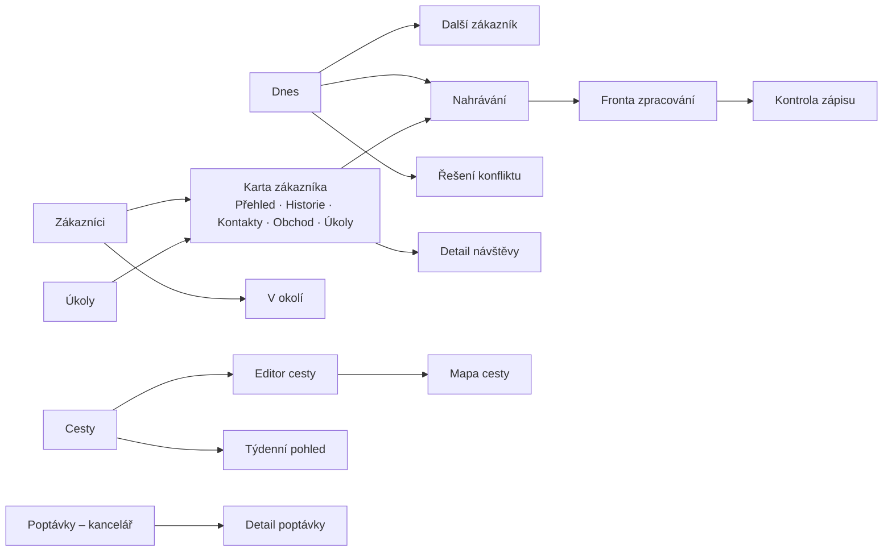

# UX_DESIGN – Návrh uživatelského rozhraní

Verze: 1.0 (návrh) · Datum: 13. 11. 2026

> Všechna jména firem, osob a adres v náčrtech jsou **fiktivní**.

---

## 1. Cíle a principy

### 1.1 Měřitelné cíle hlavních úkonů

| Úkon | Cíl |
|---|---|
| Spustit hlasový zápis | **1 klepnutí** z hlavní obrazovky |
| Navigovat k dalšímu zákazníkovi | **1 klepnutí** z hlavní obrazovky |
| Zadat „schůzka se protáhla o 15 min" | **2 klepnutí** |
| Zkontrolovat a uložit zápis | **2–4 klepnutí** (potvrzení nejistot + Uložit), ≤ 1 min |
| Celý zápis od konce schůzky po uložení | **≤ 3 min** (z toho 1–2 min mluvení) |
| Najít zákazníka | 1 klepnutí + pár písmen |

### 1.2 Principy

1. **Palec první.** Hlavní akce ve spodní třetině displeje, ovladatelné jednou rukou.
2. **Hlas místo psaní.** Psaní je záloha, ne hlavní cesta.
3. **Jedna obrazovka = jeden úkol.** Žádné přeplněné formuláře.
4. **Na první pohled.** Další zákazník, čas, rezerva a tlačítko Navigovat jsou vidět bez posouvání.
5. **Odhad vs. jistota.** Odhadované časy s vlnovkou (`~11:40`), pevné bez ní a tučně (`10:00 PEVNĚ`).
6. **Důvěra v AI.** Obsah od AI má štítek „AI návrh" (fialová), nejisté údaje jantarově s otázkou,
   citace z diktátu na klepnutí. Fakta z databáze jsou vizuálně odlišená.
7. **Nic se neztratí.** Rozpracované věci se ukládají automaticky; stav odesílání je vždy vidět.
8. **Oddělit nahrání od kontroly.** Obchodník nadiktuje a může hned jet dál; zápis zkontroluje,
   až mu to vyjde (na dalším parkovišti, večer). Aplikace na nezkontrolované zápisy upozorňuje.
9. **Bezpečnost v autě.** Aplikace se nepoužívá za jízdy; během jízdy běží navigace v Google Maps.

---

## 2. Informační architektura a navigace

### 2.1 Mobil – spodní lišta (max. 5 položek)

Zadání požaduje 7 položek hlavní navigace. Na mobilu je osvědčené maximum 5 (víc se nevejde pod palec
a zhoršuje orientaci). Návrh zachovává všech 7 funkcí, ale dvě vnoří:

| Pozice | Položka | Obsahuje (z požadovaných 7) |
|---|---|---|
| 1 | **Dnes** | Dashboard + dnešní program (kalendář dne) |
| 2 | **Zákazníci** | Seznam, karta, přepínač **V okolí** (seznam/mapa) |
| 3 – střed, velké tlačítko | **Zápis** (mikrofon) | Nová návštěva |
| 4 | **Cesty** | Plánovač, mapa, **týdenní kalendářní pohled** |
| 5 | **Úkoly** | Úkoly, follow-upy, nedokončené zápisy |

- **Kalendář** je v MVP součástí „Dnes" (den) a „Cesty" (týden). Samostatnou položkou se stane, pokud to
  ukáže integrace kalendáře.
- **V okolí** je záložka v „Zákazníci" a zároveň rychlá akce na „Dnes".

### 2.2 Notebook / desktop – levý panel

Dnes · Nová návštěva · Zákazníci · V okolí · Cesty · Kalendář · Úkoly · **Poptávky** (kancelář) ·
Nastavení. Na velké obrazovce se vejde všech 7 požadovaných položek + kancelář.

### 2.3 Mapa obrazovek



---

## 3. Uživatelské toky

### F1 – Po návštěvě (nejdůležitější tok)

1. Obchodník vyjde ze schůzky a sedne do zaparkovaného auta.
2. Otevře aplikaci → „Dnes" ukazuje aktuální zastávku → **Dokončit a zapsat**.
3. Jedno klepnutí: *Podle plánu / +15 min / +30 min / Jiné* (harmonogram se přepočítá).
4. Nahrávání se spustí samo → diktuje → **Stop**.
5. Aplikace: „Zpracovávám, můžete jet dál" → ukáže **další zastávku** s tlačítkem **Navigovat**.
6. Když je návrh hotový (do ~1 min), objeví se odznak „1 zápis ke kontrole".
7. Kontrola (hned, nebo na dalším parkovišti): potvrdí nejisté údaje → **Uložit zápis**.
8. Pokud zápis obsahuje poptávku: „Odeslat podklad kolegyni?" → **Odeslat**.

### F2 – Příprava cesty (typicky den předem, na notebooku)

1. Cesty → **Nová cesta** → datum (výchozí zítra), start (výchozí domov), čas odjezdu.
2. Přidání zastávek: hledání zákazníka, výběr na mapě, jednorázová adresa
   (P3: doporučení „dlouho nenavštívení v této oblasti").
3. U každé zastávky: typ času (výchozí OPEN), délka (výchozí 60 min), poznámka.
4. Přetažením určí pořadí; harmonogram se přepočítá okamžitě; konflikty jsou červeně.
5. **Uložit** → plán, briefingy a kontakty se stáhnou do telefonu (offline).

### F3 – Průběh dne

Ráno „Dnes" → **Zahájit cestu** → **Navigovat** → na místě „Jsem tu" (volitelné) → Briefing → schůzka →
**Dokončit a zapsat** (F1) → další zastávka → … Při hrozícím konfliktu se na „Dnes" objeví banner
„Zpoždění 12 min na pevnou schůzku 10:00 – **Řešit**".

### F4 – Předání poptávky do kanceláře

Obchodník potvrdí zápis s poptávkou → náhled podkladu (zákazník, položky, termín, poznámky, přílohy) →
**Odeslat** → kolegyně dostane e-mail (P1) / položku v přehledu poptávek (P2) → doplní údaje nebo
požádá obchodníka o doplnění → změní stav.

### F5 – Zákazník mimo plán

„Dnes" → **V okolí** → seznam podle vzdálenosti s filtry → detail → **Přidat do plánu** (za aktuální
zastávku nebo jinam) → náhled dopadu na harmonogram → potvrdit. Nic se nepřidá samo.

### F6 – První spuštění

Přihlášení → průvodce instalací na plochu (iOS/Android) → povolení mikrofonu (vysvětlení proč) →
výchozí místo cest → krátká ukázka „Jak diktovat zápis" (30 s). Poloha se žádá až při prvním použití
„V okolí".

---

## 4. Obrazovky

| ID | Obrazovka | Účel | Priorita |
|---|---|---|---|
| S01 | Přihlášení | E-mail + heslo, obnova hesla | P1 |
| S02 | **Dnes** | Aktuální/další zákazník, program, upozornění | P1 / P2 |
| S03 | **Nahrávání** | Diktát zápisu | P1 |
| S04 | Fronta zpracování | Stav nahrávek (čeká, zpracovává, ke kontrole, chyba) | P1 |
| S05 | **Kontrola zápisu** | Potvrzení návrhu AI | P1 |
| S06 | Zákazníci – seznam | Hledání, filtry, řazení | P1 |
| S07 | **Karta zákazníka** | Přehled/briefing, historie, kontakty, obchod, úkoly | P1 |
| S08 | Detail návštěvy | Uložený zápis, přílohy, vzniklé úkoly a poptávky | P1 |
| S09 | Cesty – seznam | Naplánované a minulé cesty | P2 |
| S10 | **Editor cesty** | Zastávky, pořadí, časová omezení, harmonogram | P2 |
| S11 | Mapa cesty | Zastávky a trasa na mapě | P2 |
| S12 | **Řešení konfliktu** | Návrhy řešení s náhledem | P2 |
| S13 | **Další zákazník** | Po dokončení zastávky | P2 |
| S14 | V okolí | Zákazníci poblíž | P3 |
| S15 | Úkoly | Přehled a správa úkolů | P1 |
| S16 | Kalendář | Den/týden | P3 |
| S17 | Poptávky (kancelář) | Přehled a detail poptávek | P2 (P1 = e-mail) |
| S18 | Nastavení / admin | Profil, výchozí hodnoty, uživatelé, integrace, retence | P1 (základ) |

### S02 – Dnes

```text
┌────────────────────────────────────┐
│ Dnes · čt 19. 11.            [4G]  │
├────────────────────────────────────┤
│ PROBÍHÁ: XYZ a.s. (od 08:02)       │
│ [   DOKONČIT A ZAPSAT   ]          │
├────────────────────────────────────┤
│ DALŠÍ ZASTÁVKA      10:00 PEVNĚ    │
│ ABC s.r.o. – závod Přerov          │
│ Ing. Jan Novák · nákup             │
│ Příjezd ~09:48 · jízda 34 min      │
│ Rezerva 12 min                     │
│ [       NAVIGOVAT        ]         │
│ [Briefing]          [Zavolat]      │
├────────────────────────────────────┤
│ PROGRAM DNE           0/4 hotovo   │
│ [>] 08:00   XYZ a.s.  (probíhá)    │
│ [ ] 10:00   ABC s.r.o.  (pevně)    │
│ [ ] ~11:40  DEF s.r.o.             │
│ [ ] ~14:10  GHI spol. s r.o.       │
│     ~16:30  návrat                 │
├────────────────────────────────────┤
│ ! 1 zápis čeká na kontrolu         │
│ ! 3 úkoly na dnes                  │
├────────────────────────────────────┤
│ Dnes Zákazníci (MIC) Cesty Úkoly   │
└────────────────────────────────────┘
```

### S03 – Nahrávání

```text
┌────────────────────────────────────┐
│ [x] Zápis z návštěvy               │
│ ABC s.r.o. (z plánu)    [změnit]   │
├────────────────────────────────────┤
│                                    │
│               02:14                │
│        ..::||||::..::||::..        │
│                                    │
│           [   STOP   ]             │
│           [  Pauza   ]             │
│                                    │
├────────────────────────────────────┤
│ Nezapomeňte zmínit:                │
│  - s kým jste jednal               │
│  - co jste představil              │
│  - co zákazník potřebuje           │
│  - co je domluveno a do kdy        │
├────────────────────────────────────┤
│ Funguje i bez signálu.             │
└────────────────────────────────────┘
```

Nápověda „Nezapomeňte zmínit" zvyšuje úplnost zápisu bez formuláře. Po prvních týdnech ji lze skrýt.

### S05 – Kontrola zápisu

```text
┌────────────────────────────────────┐
│ <  Kontrola zápisu    [Zahodit]    │
├────────────────────────────────────┤
│ ! ZÁKAZNÍK – potvrďte              │
│ ABC s.r.o., závod Přerov           │
│ [ Ano, správně ]   [ Jiný... ]     │
├────────────────────────────────────┤
│ ! KONTAKT – potvrďte               │
│ „pan Novák" -> Ing. Jan Novák      │
│ (nákup) [ Ano ] [ Jiný ] [ Nový ]  │
├────────────────────────────────────┤
│ Typ návštěvy          AI návrh     │
│ Obchodní návštěva            [v]   │
│ 19. 11. 2026 · 10:00–11:05         │
├────────────────────────────────────┤
│ Shrnutí            AI návrh [e]    │
│ Představeny nové válečkové         │
│ řetězy. Konkrétní poptávka         │
│ zatím není.                        │
├────────────────────────────────────┤
│ Příležitost        AI návrh [e]    │
│ Možná modernizace výrobní linky    │
│ Termín: 2027 (nejisté)             │
├────────────────────────────────────┤
│ Úkoly                              │
│ [x] Ozvat se – leden 2027          │
├────────────────────────────────────┤
│ Další kontakt: leden 2027    [e]   │
│ Poptávka: žádná                    │
│ Interní poznámka: –          [+]   │
│ Přílohy: –                   [+]   │
│ Zobrazit přepis                    │
├────────────────────────────────────┤
│ [        ULOŽIT ZÁPIS        ]     │
└────────────────────────────────────┘
```

- Nejisté údaje (`!`) jsou nahoře – obchodník je potvrdí jako první.
- Klepnutí na štítek „AI návrh" zobrazí citaci z diktátu.
- Prázdná pole se nezobrazují jako chyba, ale nabízejí „+ doplnit".
- „Uložit" je vždy dostupné ve spodní části (po potvrzení nejistot).

### S07 – Karta zákazníka (záložka Přehled = briefing)

```text
┌────────────────────────────────────┐
│ <  ABC s.r.o.                [...] │
│ Závod Přerov · Průmyslová 12       │
│ Poslední návštěva: před 47 dny     │
│ [Navigovat] [Zavolat] [Zápis]      │
├────────────────────────────────────┤
│ Přehled Historie Kontakty Obchod   │
├────────────────────────────────────┤
│ FAKTA                              │
│ Kontakty: Ing. Jan Novák (nákup),  │
│   Petr Svoboda (údržba)            │
│ Naposledy 3. 10.: vztahová         │
│   návštěva – J. Novák              │
│ Domluveno: zaslat katalog          │
│   řetězových kol (úkol otevřený)   │
│ Příležitost: modernizace linky     │
│   (2027)                           │
│ Poptávky: 1 v řešení (12B-1)       │
├────────────────────────────────────┤
│ SHRNUTÍ AI             [zdroje]    │
│ - Ověřit, zda dorazil katalog      │
│   řetězových kol.                  │
│ - Zeptat se na harmonogram         │
│   modernizace linky.               │
└────────────────────────────────────┘
```

Záložky: **Historie** (časová osa návštěv s typem a shrnutím), **Kontakty** (volat/psát jedním
klepnutím), **Obchod** (příležitosti, poptávky, nabídky), **Úkoly**.

### S10 – Editor cesty (mobil)

```text
┌────────────────────────────────────┐
│ <  Cesta · pá 20. 11.   [Uložit]   │
│ Start: Domov · odjezd 07:15        │
├────────────────────────────────────┤
│ 1 XYZ a.s., Olomouc        OPEN    │
│   příjezd ~08:00 · 60 min          │
│   jízda 45 min · rezerva 25 min    │
│ 2 ABC s.r.o., Přerov  10:00 PEVNĚ  │
│   příjezd ~09:35 · 60 min          │
│   čekání 25 min                    │
│ 3 DEF s.r.o., Hulín     9–12 h     │
│   příjezd ~11:30 · 45 min          │
│ 4 Jednorázová: Kroměříž    OPEN    │
│   příjezd ~12:30 · 30 min          │
├────────────────────────────────────┤
│ Návrat ~13:50 · 160 km             │
│ [+ Přidat zastávku]      [Mapa]    │
└────────────────────────────────────┘
```

Na notebooku: vlevo seznam zastávek s přetahováním, vpravo mapa a časová osa dne.

### S12 – Řešení konfliktu

```text
┌────────────────────────────────────┐
│ ! ZPOŽDĚNÍ NA PEVNOU SCHŮZKU       │
│ ABC s.r.o. v 10:00                 │
│ Nový odhad příjezdu: 10:12         │
│ (zpoždění 12 min)                  │
├────────────────────────────────────┤
│ Možnosti:                          │
│ ( ) Zkrátit aktuální návštěvu      │
│     o 15 min                       │
│ ( ) Přesunout GHI s.r.o. za        │
│     pevnou schůzku                 │
│ ( ) Odložit GHI s.r.o. na jiný den │
│ [ Zavolat J. Novákovi (ABC) ]      │
├────────────────────────────────────┤
│ Náhled: příjezd do ABC ~09:57      │
├────────────────────────────────────┤
│ [ Použít ]        [ Ponechat ]     │
│ Pevné schůzky se nikdy nemění      │
│ automaticky.                       │
└────────────────────────────────────┘
```

### S13 – Další zákazník

```text
┌────────────────────────────────────┐
│ Hotovo: XYZ a.s. (zápis ve frontě) │
├────────────────────────────────────┤
│ DALŠÍ: ABC s.r.o.                  │
│ Závod Přerov, Průmyslová 12        │
│ Ing. Jan Novák · nákup             │
│ PEVNĚ 10:00 · příjezd ~09:48       │
│ Jízda 34 min · rezerva 12 min      │
│ Pozor: vjezd z boční ulice,        │
│ hlásit se na vrátnici.             │
├────────────────────────────────────┤
│ [NAVIGOVAT DO DALŠÍHO ZÁKAZNÍKA]   │
├────────────────────────────────────┤
│ [Briefing] [Zavolat] [Přeskočit]   │
└────────────────────────────────────┘
```

### S14 – V okolí

```text
┌────────────────────────────────────┐
│ <  V okolí        [Seznam | Mapa]  │
│ Okruh: 5  [10]  25  50 km          │
│ [x] Nenavštíveno déle než 90 dní   │
├────────────────────────────────────┤
│ KLM a.s.                  3,2 km   │
│ Naposledy před 140 dny (vztahová)  │
│ 1 otevřená příležitost             │
│ [Detail]          [+ Do plánu]     │
├────────────────────────────────────┤
│ NOP s.r.o.                7,8 km   │
│ Naposledy před 95 dny (obchodní)   │
│ [Detail]          [+ Do plánu]     │
├────────────────────────────────────┤
│ Poloha se nikam neukládá.          │
└────────────────────────────────────┘
```

### S15 – Úkoly

```text
┌────────────────────────────────────┐
│ Úkoly               [+ Nový úkol]  │
│ Po termínu (1) · Dnes (3) · Týden  │
├────────────────────────────────────┤
│ ! Zavolat – QRS s.r.o.     včera   │
│ [ ] Poslat výkres – ABC     dnes   │
│ [ ] Ověřit specifikaci 12B-1       │
│     DEF s.r.o.              dnes   │
│ [ ] Ozvat se – ABC  leden 2027     │
└────────────────────────────────────┘
```

### S17 – Poptávky (kancelář, desktop)

```text
┌──────────────────────────────────────────────────────────────────────────────┐
│ Poptávky                              [Nové 2]  [V řešení 3]  [Vše]          │
├──────────────────────────────────────────────────────────────────────────────┤
│ NOVÁ  ABC s.r.o.   Řetěz 12B-1, 20 m + 2 kola    Obchodník A   dnes 11:20    │
│ NOVÁ  DEF s.r.o.   Ozubený hřeben                Obchodník A   dnes 14:05    │
│ ŘEŠÍ  GHI s.r.o.   Dopravní řetěz (dle výkresu)  Obchodník A   18. 11.       │
├──────────────────────────────────────────────────────────────────────────────┤
│ ABC s.r.o. – závod Přerov · Ing. Jan Novák (nákup)                           │
│ Položky:                                                                     │
│   1. Válečkový řetěz 12B-1 ........................ 20 m                     │
│   2. Řetězové kolo – parametry nezazněly ........... 2 ks   ! doplnit        │
│ Termín nabídky: středa 25. 11.                                               │
│ Technické poznámky: dle diktátu                       [Zobrazit přepis]      │
│ Přílohy: foto_stitek.jpg                                                     │
│ [Převzít]   [Chybí informace -> obchodník]   [Nabídka odeslána]              │
└──────────────────────────────────────────────────────────────────────────────┘
```

---

## 5. Vizuální jazyk

| Prvek | Návrh |
|---|---|
| Charakter | Profesionální průmyslový nástroj: klidný, kontrastní, bez dekorací |
| Primární barva | Tmavě modrá (akce, navigace) |
| AI obsah | Fialový štítek „AI návrh" + jemné pozadí |
| Nejistota | Jantarová + ikona otazníku + text otázky |
| Konflikt, chyba | Červená |
| Hotovo | Zelená |
| Pevná schůzka | Tučný čas + štítek „PEVNĚ" |
| Odhad | Vlnovka před časem (`~11:40`) |
| Písmo | Systémové (SF Pro / Roboto) nebo Inter; základ 17 px na mobilu; časy 20 px s pevnou šířkou číslic |
| Dotykové cíle | Min. 48 × 48 px; hlavní tlačítka 56–64 px vysoká, přes celou šířku |
| Ikony | Jednotná sada (např. Lucide), vždy s popiskem u hlavních akcí |
| Režimy | Světlý / tmavý podle systému; vysoký kontrast pro práci na slunci |

Barva nikdy není jediným nositelem významu (vždy i text nebo ikona).

---

## 6. Stavy a texty (microcopy)

| Situace | Text |
|---|---|
| Bez signálu | „Jste offline. Nahrávání funguje, odešle se samo." |
| Fronta | „Čeká na odeslání: 2 zápisy" |
| Zpracování | „Zpracovávám zápis… můžete pokračovat." |
| Hotovo ke kontrole | „Zápis z ABC s.r.o. je připraven ke kontrole." |
| Chyba zpracování | „Zápis se nepodařilo zpracovat. Nahrávka je v bezpečí. [Zkusit znovu]" |
| Nejistota AI | „Není jasné, se kterým panem Novákem jste jednal. Vyberte prosím." |
| Neověřená adresa | „Adresa není ověřená – navigace podle textu. [Ověřit na mapě]" |
| Odhad bez dopravy | „Časy bez aktuální dopravy (offline)." |
| Prázdné úkoly | „Žádné úkoly. Vznikají automaticky ze zápisů." |
| Málo historie | „Zatím málo historie pro shrnutí." |
| Poloha | „Poloha slouží jen k zobrazení zákazníků v okolí a nikam se neukládá." |

---

## 7. Přístupnost a bezpečnost v autě

- Kontrast WCAG 2.1 AA, škálování písma podle systému, popisky pro čtečky obrazovky.
- Žádné akce vázané jen na gesta (vždy i tlačítko).
- Aplikace **nevybízí k používání za jízdy**: žádné notifikace vyžadující reakci během navigace;
  tlačítko Navigovat předá řízení aplikaci Google Maps. Používání telefonu za jízdy (mimo hands-free)
  je v ČR zakázáno.
- Nahrávání a kontrola jsou navrženy pro zaparkované auto.

---

## 8. Ověření návrhu před vývojem

1. **Klikací prototyp** obrazovek S02, S03, S05, S07, S10, S13 (Figma nebo jednoduchý HTML prototyp).
2. **Test s obchodníkem** (30–45 min, nahlas komentuje), 5 úkolů:
   1. Zapiš návštěvu, ze které právě odcházíš.
   2. Zkontroluj a ulož zápis s jedním nejasným kontaktem.
   3. Najdi, co jsi naposledy domluvil s firmou ABC.
   4. Naplánuj zítřejší cestu se 4 zákazníky, jeden má pevný čas.
   5. Schůzka se protáhla o 30 min – co se stane s dalším programem?
3. Měřit: úspěšnost, čas, počet chyb, místa váhání. Upravit návrh.
4. Krátký test i s kolegyní (S17 / e-mailový podklad): je podklad pro nabídku úplný?
